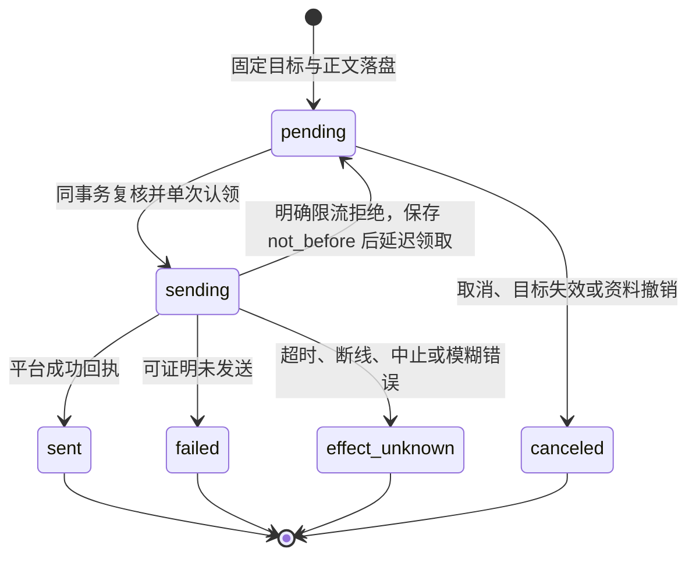

# 通用调度与通知 outbox

## 职责与边界

[个人 durable](personal-durable.md) 在 app 内持有独立的计划、运行、权限来源与发送 Task，只复用本模块 `time.ts` 的时间计算。正式个人 bin、根启动脚本、开发启动器和部署入口均使用该 durable 装配；下述 SchedulerStore 留在旧底座，Coding Agent 不开放个人调度，但仍可核实共享旧操作。两种装配不共用计划或发送账本。

旧底座实现使用本模块的时间规则、调度计划、独立运行与通知发送账本，代码在 `packages/channels/src/scheduler/` 的 `time.ts`、`store.ts`、`runtime.ts`。计划只表达时间与自足任务说明，每次到期由运行时建立独立的个人助手会话，使用已有工具完成工作。新闻、提醒、巡检等业务由说明与工具表达，不设专用动作。

独立运行的会话身份、任务、委派、整项收尾与进程停止归 [runtime](runtime.md)。渠道的配置、身份与发送协议归 [channels](channels.md)。本模块不提供业务数据表；`schedules`、`schedule_runs`、`notification_ops` 位于核心库，应用数据工具不可访问。该调度器不再由正式个人入口装配，Coding Agent 不开放创建工具。

内存计时器只唤醒扫描，时间与执行事实以数据库为准。计划执行与日常主聊天分别排队，等待审批或长任务不占用主聊天。

## 对外接口

### 个人 durable

定时会话及其子身份沿[个人资料归属](personal-durable.md)使用自身历史和记忆；技能只提供参考。封组汇总可查询记忆、查原文与读技能，不能再变更记忆。

主会话以 `schedule_create`、`schedule_query`、`schedule_cancel` 管理计划，创建来源必须是活动拥有者输入。本机第26项管理菜单与 QQ/Telegram `/定时` 使用逐步引导与原菜单确认，所有键由程序生成；创建丢答按原键查询。模型和宿主控制共用同一创建事务；创建工具的任务说明参数列出目标会话的 `delegate/list/result/cancel` 与自动收尾流程。独立定时会话只能使用创建时开放的业务工具与本次成员委派，不开放计划创建和普通通知工具；原生后台自动整项收尾。

### 旧底座实现

旧个人的 `schedule_*` 与 `notification_*` 模型工具装配已删除，Coding 不提供这些创建或外发工具。共享实现保留时间计算、旧计划/运行与发送账本、来源核实、恢复分类和控制查询；下述流程描述这些保留的库实现，不是个人正式入口。

拥有者控制面提供 `schedule_list/get/cancel` 与 `notification_list/get/cancel`；每页最多50项，计划列表不带完整说明，详情包含最近运行与结果。命令用法见[操作手册](../usage.md)。模型不能通过这些控制接口指定权限或改目标。

`SchedulerDeps.runOutcome` 同步查询首次任务、全部派生工作与汇总的终态；未完成返回空值。`cancelRun` 在取消事实提交后停止整项运行。派发使用真实的 `source=scheduler` 入站事件与运行 ID，运行时按保存的计划模式建立新会话，不伪造 IM 入站身份。

通知渠道一次只发送一条固定正文：成功返回平台消息 ID，可证明未发送抛 `NotSentError`，明确限流且可证明未发送抛 `RetryLaterError`。渠道不能隐藏重试或拆分多条。未加载或暂时离线时操作保留 `pending`，显示等待原因。

## 数据与状态

### 个人 durable

定时会话及其子身份沿[个人资料归属](personal-durable.md)使用自身历史和记忆；技能只提供参考。封组汇总可查询记忆、查原文与读技能，不能再变更记忆。

`ruukoto.schedules`、`ruukoto.schedule` 与 `ruukoto.schedule-run` 保存计划、唯一运行、创建模式及权限版本、工具和资料快照、真实定时来源、成员、整项结果及固定目标发送事实。运行和发送分别由原生 Task 执行，状态从 Task/Submission 派生；接纳、结果、取消和发送均保留不可改反链。具体字段见[个人持久会话](personal-durable.md#数据与状态)。

### 旧底座实现

| 表 | 关键内容 | 生命周期 |
|---|---|---|
| `schedules` | 创建键与参数摘要、来源任务/操作、`project_id`、创建时权限版本、`access_mode`、时间规则、`instruction`、`source_refs`、固定 `target`、下次时间与当前运行 | `active` → `completed`（一次性运行结束）或 `canceled`；修改通过取消后重建 |
| `schedule_runs` | 计划/版本/原定时刻、当地时间、延迟与合并区间、来源事件、独立 `session_id`/`root_task_id`、`result_status`/`result_text`、最终回报操作与关闭时刻 | 登记 → 绑定执行 → 整项终态；同计划最多一个未关闭运行 |
| `notification_ops` | 来源种类/键、来源任务/宿主操作、固定目标/正文/来源引用、发送状态、等待原因、错误、平台回执与取消意图 | 固定发送键只认领一次，结果未知不重放 |

运行绑定只在未派发阶段为空；派发事务同时保存独立会话、首次任务与事件归属。`(schedule_id, schedule_version, scheduled_for)` 唯一，未关闭运行有按计划的唯一索引。

通知来源 `schedule_run` 表示一次整项运行的最终回报，键为运行 ID；`tool` 表示普通一次通知，键为任务通知槽，`host_op_id` 关联工具账本的真实授权；`confirmation` 供 IM 初始审批通知使用，`workflow_question` 按运行/步骤/问题版本通知业务等待；`owner_reply` 与 `inbound_event` 保留原入口回复、控制回执与 GitHub 汇报。完全访问的通知关联 `tool_ops.authorization.source=full_access`，不创建伪人工批准。受限通知关联已消费的固定范围批准。

在途取消只记录意图，按实际发送结果收尾；明确限流回退时已有取消意图则转 `canceled`。迟到回执保存在原操作，不改终态、不重发。完整最终结果保存在运行记录；消息回报超过2000字符时给出有界文本和完整记录指引。

## 主要流程

### 个人 durable

定时会话及其子身份沿[个人资料归属](personal-durable.md)使用自身历史和记忆；技能只提供参考。封组汇总可查询记忆、查原文与读技能，不能再变更记忆。

一次性、每日和每周规则复用下述时间语义。扫描以计划、版本和原定时刻登记唯一运行，建立独立会话并提交真实定时输入；同计划有在途运行时只合并周期，无在途时只补最近一次，不重放所有漏过周期。首次回答结束后宿主自动封组，等待全部派生工作与外部活动停止，再在该会话中以查询工具汇总。汇总正文只交付业务结果、失败和未完成之处，生成后的发送状态由宿主记录并供查询。同事务保存完整结果、关闭运行并登记唯一发送意图；独立发送 Task 等待原目标可用，不阻止下一周期。本机计划没有外发目标，结果只留本机。

### 旧底座实现

一次性规则要求带明确偏移的时刻；每日、每周规则使用 IANA 时区，周内按 ISO 星期。DST 空隙向后移，重叠取第一次，下一周期回到原当地钟点；时间计算沿用 Temporal。

扫描默认每秒一次，每批50项、每轮最多20批，活跃计划最多1000项。在短事务内重读计划、登记或合并运行、推进下次时间与登记来源事件，提交后由运行时派发。每次输入只含本次计划说明与明确资料，不自动复制主聊天或前次历史。

同计划仍有未完成运行时，到期只合并漏过区间，不新建任务。停机漏过多次且没有未完成运行时，只登记最近一次，保留合并范围；已登记未派发的事件按原键恢复。发送器的离线等待不阻止已经完成的运行关闭或下一周期执行。

首次任务、派生 SubAgent、工作内消息与最后汇总全部收尾后，同事务保存整项结果、关闭运行、登记唯一最终回报，并完成一次性计划。未绑定目标的结果只留记录；失败也产生固定目标的最终诊断；取消的运行不生成成功汇报。发送循环在认领事务提交后调用渠道一次。

名下工作流仍排队、运行、等待回答或暂停时，调度保持开放；终态后等待实际停止和每项唯一汇总，步骤不产生普通子任务 wake。安全重试恢复成功的历史尝试不再判整项失败，宿主各运行状态与覆盖清单先于模型摘要进入最终回报。工作流不另发 owner_reply；计划取消级联整项运行，自身步骤发起取消先提交意图并异步停止，避免等当前工具返回的死锁。问题通知与最终回报都在发送前重核依赖资料，旧入口不改发。

等待父轮或同来源分组汇总完成的报告也计入整项收尾，保留但不再领取的排队报告别名不阻塞关闭；最终外发仍只由原 `schedule_run` 持有，不因等待接管新增直接通知。

取消先保存计划状态、使未派发事件失效，再在事务外停止排队、执行、等待审批的任务与派生工作。迟到消息、结果与审批不能恢复已取消运行。执行记录、工作副本与已有成果保留。

名下子工作基线缺失或损坏时，终态与停止核实仍按真实 Task/占用判断；全部可收尾后将整项记为失败并保留父最终回复。取消坏工作仍继续停止已登记 Task，保留损坏记录与副本，不因解析失败跳过安全停止。独立工作副本宿主 Task 不作为模型任务或额外子结果参与最终汇总。

## 不变量与失败处理

### 个人 durable

定时会话及其子身份沿[个人资料归属](personal-durable.md)使用自身历史和记忆；技能只提供参考。封组汇总可查询记忆、查原文与读技能，不能再变更记忆。

创建时固定模式、权限版本、工具及资料范围和可选原 IM 目标；默认模式改变不扩大旧计划。工具、资料授权、MCP、命令、浏览器、技能目录配置或服务策略内容变化时停止旧计划的后续新执行，核实未决效果后取消重建。运行和成员沿真实定时来源检查取消与同源未知效果，未知时暂停外调、委派和汇总；逐次审批不继承或创建长期授权。取消先落盘，再收齐名下模型、成员和外部活动；未核实停止继续占用，迟到结果不恢复运行或发送成功。

最终回报固定原平台、账号、拥有者和代次，目标失效取消未发送操作；本机计划不因后来绑定 IM 而取得目标。发送开始后丢答、取消或重启保留效果未知，不自动重发；只有明确未发送的限流沿原意图延迟。完整结果保存在原运行，平台正文有界。缺少计划、成员、真实输入或原生 Task 反链时拒绝恢复。

### 旧底座实现

访问模式固定于创建时。更改主会话默认模式或重启不重算已有计划权限；模型输入不提供升级来源，单次批准与限定长期授权不随计划继承。完全访问使用共享工具免审批；受限模式在独立运行中按原策略等待决定。审批绑定计划创建时的原 IM 入口与目标代次，无 IM 时经 TUI/控制面处理。

计划登记前重核活动任务、权限版本、身份、目标与资料；普通通知授权与 outbox 同事务提交。实际发送前在认领事务重核目标、资料和来源授权；一次通知的源任务完成后仍可发送，取消或权限版本变化使未发送授权失效。目标停用、配置或凭据代次变化时取消旧发送，不改发给新目标。

计划因资料已撤销等原因完全未启动时，最终失败报告只含宿主通用诊断，不含原说明或资料，因此不引用撤销资料。已经开始或产出结果的回报仍携带原资料引用，发送前再次复核撤销状态。

收尾或发送意图落盘失败回滚整笔事务；不留下已关闭却无回报记录的半条运行。停止与重启把遗留 `sending` 定为 `effect_unknown`，保留原键与事实，不自动换键重发；明确限流拒绝是唯一可回到 `pending` 的情形。计划取消不撤回文件修改、已发消息、外部服务或无法核实退出的进程，未核实占用由运行时保留。

旧任务或计划格式直接拒绝，不转换业务动作、不回填模式。独立实例导入只接受当前通用计划格式，保留创建模式与固定目标；导入中的未结束运行按中断收尾，不重新执行旧运行。

保留的旧操作按原来源、资料范围与业务库身份核实；旧个人模型工具和普通通知创建入口已退出，不能从当前工作流恢复这些调用。

## 设计依据

- [个人持久调度的独立来源与整项收尾](../../.agents/notes/implemented/architecture/2026-10-18-personal-durable-scheduled-work.md)

- [当前工作区快照与失败隔离](../../.agents/notes/implemented/architecture/2026-10-15-current-workspace-snapshots.md)

- [等待让出与唯一报告归属](../../.agents/notes/implemented/architecture/2026-10-14-agent-wait-and-report-ownership.md)

- [工作流业务回答与整项最终送达](../../.agents/notes/implemented/feature/2026-10-13-workflow-owner-input-and-delivery.md)

- [工作流真实步骤与冻结成果](../../.agents/notes/implemented/architecture/2026-10-13-workflow-step-capabilities.md)

- [调度计划只触发独立的通用任务](../../.agents/notes/implemented/feature/2026-10-12-generic-scheduled-tasks.md)：独立上下文、创建授权、整项生命周期与固定最终回报。
- [完全访问使用启动账户且不请求审批](../../.agents/notes/implemented/feature/2026-10-12-full-access-current-account.md)：真实任务授权与共享工具行为。
- [调度器与通知 outbox](../../.agents/notes/implemented/architecture/2026-09-24-scheduler-outbox.md)：时间、唯一发送键与效果未知。

- [普通与工作流的可信来源能力](../../.agents/notes/implemented/architecture/2026-10-15-subagent-source-capabilities.md)。
