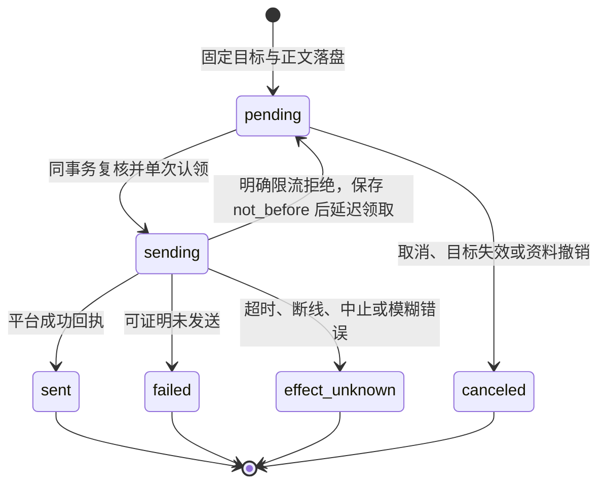

# 通用调度与通知 outbox

## 职责与边界

本模块持有时间规则、调度计划、独立运行与通知发送账本，代码在 `packages/channels/src/scheduler/` 的 `time.ts`、`store.ts`、`runtime.ts`。计划只表达时间与自足任务说明，每次到期由运行时建立独立的个人助手会话，使用已有工具完成工作。新闻、提醒、巡检等业务由说明与工具表达，不设专用动作。

独立运行的会话身份、任务、委派、整项收尾与进程停止归 [runtime](runtime.md)。渠道的配置、身份与发送协议归 [channels](channels.md)。本模块不提供业务数据表；`schedules`、`schedule_runs`、`notification_ops` 位于核心库，应用数据工具不可访问。调度只在 ruukoto 装配，Coding Agent 不开放创建工具。

内存计时器只唤醒扫描，时间与执行事实以数据库为准。计划执行与日常主聊天分别排队，等待审批或长任务不占用主聊天。

## 对外接口

个人助手会话（main 或宿主绑定的独立定时执行）使用以下工具：

| 工具 | 作用 |
|---|---|
| `schedule_create` | 保存创建键、时间规则、自足任务说明、明确资料与理由 |
| `schedule_query` | 查询计划、创建模式、执行会话、整项结果与回报状态 |
| `schedule_cancel` | 停止未来触发并取消当前整项运行 |
| `notification_enqueue` | 向可信固定目标登记一次通知 |
| `notification_query` | 查询发送状态、错误与平台回执 |
| `notification_cancel` | 取消未发送操作，或登记在途取消意图 |

`schedule_create` 不接受模式、身份、目标或业务动作参数。宿主从活动来源任务保存访问模式、权限版本与资料项目，解析明确资料后嵌入说明，并保存来源引用；回报目标只来自可信配置。无 IM 目标仍可创建，结果只留在运行记录。创建键在个人助手范围内唯一；同键同说明、模式、目标与资料返回原计划，异参冲突。修改时间或说明需取消后重建。

拥有者控制面提供 `schedule_list/get/cancel` 与 `notification_list/get/cancel`；每页最多50项，计划列表不带完整说明，详情包含最近运行与结果。命令用法见[操作手册](../usage.md)。模型不能通过这些控制接口指定权限或改目标。

`SchedulerDeps.runOutcome` 同步查询首次任务、全部派生工作与汇总的终态；未完成返回空值。`cancelRun` 在取消事实提交后停止整项运行。派发使用真实的 `source=scheduler` 入站事件与运行 ID，运行时按保存的计划模式建立新会话，不伪造 IM 入站身份。

通知渠道一次只发送一条固定正文：成功返回平台消息 ID，可证明未发送抛 `NotSentError`，明确限流且可证明未发送抛 `RetryLaterError`。渠道不能隐藏重试或拆分多条。未加载或暂时离线时操作保留 `pending`，显示等待原因。

## 数据与状态

| 表 | 关键内容 | 生命周期 |
|---|---|---|
| `schedules` | 创建键与参数摘要、来源任务/操作、`project_id`、创建时权限版本、`access_mode`、时间规则、`instruction`、`source_refs`、固定 `target`、下次时间与当前运行 | `active` → `completed`（一次性运行结束）或 `canceled`；修改通过取消后重建 |
| `schedule_runs` | 计划/版本/原定时刻、当地时间、延迟与合并区间、来源事件、独立 `session_id`/`root_task_id`、`result_status`/`result_text`、最终回报操作与关闭时刻 | 登记 → 绑定执行 → 整项终态；同计划最多一个未关闭运行 |
| `notification_ops` | 来源种类/键、来源任务/宿主操作、固定目标/正文/来源引用、发送状态、等待原因、错误、平台回执与取消意图 | 固定发送键只认领一次，结果未知不重放 |

运行绑定只在未派发阶段为空；派发事务同时保存独立会话、首次任务与事件归属。`(schedule_id, schedule_version, scheduled_for)` 唯一，未关闭运行有按计划的唯一索引。

通知来源 `schedule_run` 表示一次整项运行的最终回报，键为运行 ID；`tool` 表示普通一次通知，键为任务通知槽，`host_op_id` 关联工具账本的真实授权；`confirmation` 供 IM 初始审批通知使用；`owner_reply` 与 `inbound_event` 保留原入口回复、审批回执与 GitHub 汇报。完全访问的通知关联 `tool_ops.authorization.source=full_access`，不创建伪人工批准。受限通知关联已消费的固定范围批准。

在途取消只记录意图，按实际发送结果收尾；明确限流回退时已有取消意图则转 `canceled`。迟到回执保存在原操作，不改终态、不重发。完整最终结果保存在运行记录；消息回报超过2000字符时给出有界文本和完整记录指引。

## 主要流程

一次性规则要求带明确偏移的时刻；每日、每周规则使用 IANA 时区，周内按 ISO 星期。DST 空隙向后移，重叠取第一次，下一周期回到原当地钟点；时间计算沿用 Temporal。

扫描默认每秒一次，每批50项、每轮最多20批，活跃计划最多1000项。在短事务内重读计划、登记或合并运行、推进下次时间与登记来源事件，提交后由运行时派发。每次输入只含本次计划说明与明确资料，不自动复制主聊天或前次历史。

同计划仍有未完成运行时，到期只合并漏过区间，不新建任务。停机漏过多次且没有未完成运行时，只登记最近一次，保留合并范围；已登记未派发的事件按原键恢复。发送器的离线等待不阻止已经完成的运行关闭或下一周期执行。

首次任务、派生 SubAgent、工作内消息与最后汇总全部收尾后，同事务保存整项结果、关闭运行、登记唯一最终回报，并完成一次性计划。未绑定目标的结果只留记录；失败也产生固定目标的最终诊断；取消的运行不生成成功汇报。发送循环在认领事务提交后调用渠道一次。

取消先保存计划状态、使未派发事件失效，再在事务外停止排队、执行、等待审批的任务与派生工作。迟到消息、结果与审批不能恢复已取消运行。执行记录、工作副本与已有成果保留。

## 不变量与失败处理

访问模式固定于创建时。更改主会话默认模式或重启不重算已有计划权限；模型输入不提供升级来源，单次批准与限定长期授权不随计划继承。完全访问使用共享工具免审批；受限模式在独立运行中按原策略等待决定。审批绑定计划创建时的原 IM 入口与目标代次，无 IM 时经 TUI/控制面处理。

计划登记前重核活动任务、权限版本、身份、目标与资料；普通通知授权与 outbox 同事务提交。实际发送前在认领事务重核目标、资料和来源授权；一次通知的源任务完成后仍可发送，取消或权限版本变化使未发送授权失效。目标停用、配置或凭据代次变化时取消旧发送，不改发给新目标。

计划因资料已撤销等原因完全未启动时，最终失败报告只含宿主通用诊断，不含原说明或资料，因此不引用撤销资料。已经开始或产出结果的回报仍携带原资料引用，发送前再次复核撤销状态。

收尾或发送意图落盘失败回滚整笔事务；不留下已关闭却无回报记录的半条运行。停止与重启把遗留 `sending` 定为 `effect_unknown`，保留原键与事实，不自动换键重发；明确限流拒绝是唯一可回到 `pending` 的情形。计划取消不撤回文件修改、已发消息、外部服务或无法核实退出的进程，未核实占用由运行时保留。

旧任务或计划格式直接拒绝，不转换业务动作、不回填模式。独立实例导入只接受当前通用计划格式，保留创建模式与固定目标；导入中的未结束运行按中断收尾，不重新执行旧运行。

[工作流步骤](workflows.md)可沿个人来源使用调度和通知工具，宿主从运行保存的目标取原渠道及配置代次，来源换代立即阻断后续调用。资料解析同时核实启动授权与当前范围，禁止跨运行步骤产物及 prompt 快照；业务数据实例失效拒绝引用。

## 设计依据

- [工作流真实步骤与冻结成果](../../.agents/notes/implemented/architecture/2026-10-13-workflow-step-capabilities.md)

- [调度计划只触发独立的通用任务](../../.agents/notes/implemented/feature/2026-10-12-generic-scheduled-tasks.md)：独立上下文、创建授权、整项生命周期与固定最终回报。
- [完全访问使用启动账户且不请求审批](../../.agents/notes/implemented/feature/2026-10-12-full-access-current-account.md)：真实任务授权与共享工具行为。
- [调度器与通知 outbox](../../.agents/notes/implemented/architecture/2026-09-24-scheduler-outbox.md)：时间、唯一发送键与效果未知。
