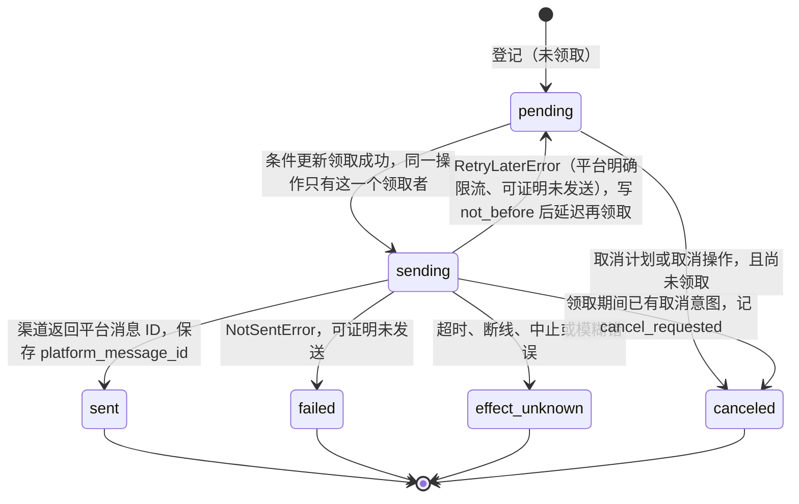
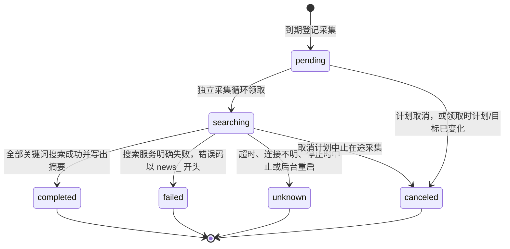
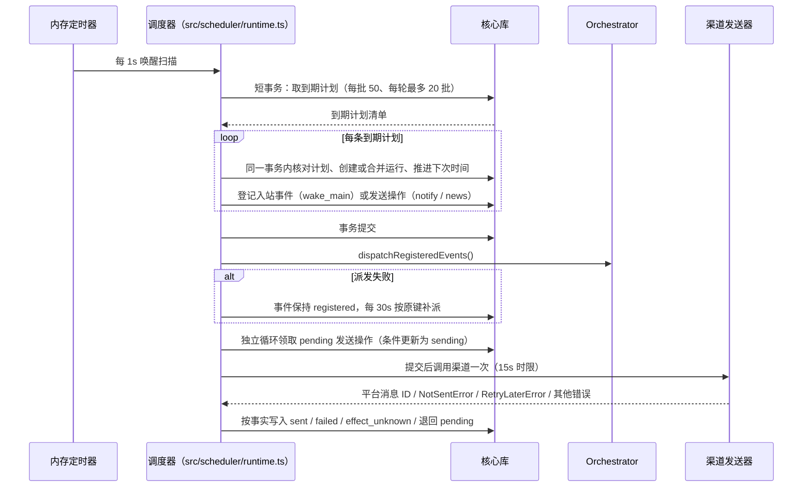

# 调度器与通知 outbox

## 职责与边界

本模块是单进程 SQLite 调度器与通知 outbox，代码在 `src/scheduler/`（`runtime.ts`、`time.ts`、`news.ts`、`store.ts`）。它负责四件事：按一次性、每日、每周的时间规则算出到期时刻；把每次到期登记为一次调度运行；把已批准的固定正文或已批准范围的新闻采集结果登记为发送操作并投递到渠道；把规则、运行与发送事实持久化到核心库，使提醒跨重启不丢失、发送应答丢失不被当成未发送。

它不负责模型调用与任务执行：`wake_main` 只登记一条入站事件，由编排器建 main 任务；`notify` 不为每次提醒启动模型。它不负责渠道协议细节：Telegram 与 QQ 的收发、配置与凭据归渠道模块，本模块只定义 outbox 与渠道之间的单人调用接口。它不负责命令与配置入口：`ruukoto schedule list|show|cancel`、`ruukoto notify list|show|cancel` 的用法归操作手册。它也不是 main 的业务表：`schedules`、`schedule_runs`、`notification_ops` 是运行时基础设施表，位于核心 `ruukoto.db`，应用数据工具不可达；main 的待办、提醒、习惯等业务数据仍在应用数据空间。

内存定时器只负责唤醒扫描。规则、下次时间、运行与发送状态一律以数据库为准，进程重启不依赖内存中的计时。

## 对外接口

**main 宿主工具**（仅 main 装配，`ToolCategory` 含 `scheduler`）：

| 工具 | 作用 |
|---|---|
| `schedule_create` | 登记一次性、每日或每周计划，带动作、时区与理由 |
| `schedule_query` | 按 `schedule_id` 查计划；带 `run_id` 读该次运行的采集快照 |
| `schedule_cancel` | 取消计划，停止未来触发 |
| `notification_enqueue` | 登记一次固定正文外发 |
| `notification_query` | 查发送操作与错误；可看到 `failed` 与 `news_*` 错误 |
| `notification_cancel` | 取消尚未发送的操作 |

创建键在 main 范围内唯一：同键同参返回原计划，同键异参冲突拒绝。

**控制面 op**：`schedule_list` / `schedule_get` / `schedule_cancel`、`notification_list` / `notification_get` / `notification_cancel`。每页 ≤50，列表不带正文，详情可读正文与快照。控制面不获得发送或改目标能力。

**命令**：`ruukoto schedule list|show|cancel`、`ruukoto notify list|show|cancel`，`ruukoto schedule show <id>` 也显示最近运行。命令的完整用法归操作手册，本篇只列 op 与工具名。审批在 TUI 完成，不在这两个入口。

**渠道接口**：宿主向调度器注入一个发送器，契约是「发送一次，返回平台消息 ID；可证明未发送抛 `NotSentError`，可稍后再试抛 `RetryLaterError`；不得隐藏重试或拆分多条」。调用有 15 秒时限。渠道暂时离线或发送器未加载时发送器返回不可用，操作保留 `pending` 并写等待原因。目标只来自可信宿主渠道：测试可注入 `RuntimeConfig.scheduler.channel`，缺省为 Telegram 适配器；未配置即拒绝创建外发。

**编排器接口**：登记事件后调用 `Orchestrator.dispatchRegisteredEvents()` 派发。`wake_main` 登记 `source=scheduler`、`external_id=<运行 ID>` 的入站事件，经编排器建 main 任务；宿主固定 `confirm` 模式，正文不能设权限，唤醒任务不继承外发授权。派发失败的事件保持 `registered`，每 30 秒按原键补派。

**搜索接口**：新闻采集与 Web Search 工具共用结构化的 `searchTavily`，不新增搜索服务或依赖。main 项目的 Web Search 必须启用，已有 `purpose=tavily_search` 的凭据还须允许 main 项目使用；创建计划、确认提交、采集与发送前都会核对。

**审批接口**：`notify` 计划与 `notification_enqueue` 的每一次发送都进入统一审批，`ApprovalScope.kind = notification`，`ApprovalScope.mode` 取 `schedule | once | news`。新闻计划的审批记录的正文是宿主生成的策略说明。GitHub webhook 的一次固定 owner 摘要走独立的 `inbound_event` 来源，在启用入口时授权，不经过模型通知工具。

## 数据与状态

核心库新增三张运行时基础设施表（首次出现于 schema v13）：

**`schedules`**：`id`、`owner_role`（固定 `main`）、`create_key`（唯一）、`params_digest`、`create_task_id`、`create_op_id`、`action`（`wake_main` / `notify` / `news`）、`rule`、`payload`、`target`、`approval_id`、`status`（`active` / `completed` / `canceled`）、`next_due_at`、`current_run_id`、`version`、`tz_data`、`reason`、`cancel_reason`、`cancel_op_id`、`created_at`、`updated_at`。`tz_data` 记录计算时的 Node、ICU 与 tz 版本。

**`schedule_runs`**：`id`、`schedule_id`、`schedule_version`、`scheduled_for`、`local_time`、`registered_at`、`delay_ms`、`coalesced_from`、`coalesced_to`、`inbound_event_id`、`notification_op_id`、`closed_at`、`news_result`。`(schedule_id, schedule_version, scheduled_for)` 唯一；`closed_at IS NULL` 上建唯一索引，保证每计划最多一个未关闭运行。

**`notification_ops`**：`id`、`source_kind`（`schedule_run` / `confirmation` / `owner_reply` / `inbound_event`）、`source_key`、`task_id`、`host_op_id`、`target`、`text`、`text_sha256`、`source_refs`、`status`、`wait_reason`、`error_kind`、`error_message`、`platform_message_id`、`cancel_requested`、`cancel_op_id`、`late_receipt`、`created_at`、`sending_at`、`settled_at`、`updated_at`。`(source_kind, source_key)` 唯一即逻辑发送键：同键同参返回原记录，同键异参拒绝。逻辑发送键由宿主决定——定时通知用运行 ID，一次确认用任务通知槽，owner 回复用入站事件与固定回复槽，GitHub 事件有独立的固定事件槽；模型不能生成新键绕过未知结果。

**发送操作状态机**：



`sent` / `failed` / `effect_unknown` / `canceled` 都是终态、都不自动重发。迟到回执保存在原操作上，不改状态、不重发。

**正文来源**：`text`（直接文本）、`task_result`（已完成且有结果的任务）、`artifact`（UTF-8 片段）、`app_data`（行字段）。登记前解析为最终文本并记录版本与摘要；业务行以后变化不改变已批准正文，发送前仍重核可撤销的资料授权。

**新闻采集快照** `schedule_runs.news_result` 的状态取下列值：

| 状态 | 含义 | 对应的发送记录 |
|---|---|---|
| `pending` | 已登记，尚未开始采集 | 无 |
| `searching` | 已领取，正在搜索 | 无 |
| `completed` | 全部关键词搜索成功 | `pending` 操作，正文为该次摘要 |
| `failed` | 搜索服务明确失败（限流、服务错误、畸形响应等） | `failed`，`news_<错误代码>` |
| `unknown` | 结果不明：超时、连接失败、停止时中止或后台重启（`timeout`、`unavailable`、`canceled`、`backend_restart`） | `failed`，`news_<错误代码>` |
| `canceled` | 计划已取消，或领取时计划或目标已变化（`schedule_canceled`、`target_or_schedule_changed`） | 无 |



**快照内容**：窗口起止；每次查询的关键词、查询时间与服务请求 ID；每条结果的 URL、标题、发布时间、查询时间、摘要（不超过 500 字符）与 `summarySource=tavily_search.content`。快照每次最多 32 KiB，超限时后续结果不保存并标记 `truncated`。

schema v18 保留旧计划、运行和发送记录，仅增加新闻动作与运行中的有界快照。首次引入时三张表随核心库一起建立；升级保留全部既有计划、调度运行与发送账本，旧运行的 `news_result` 为空。

## 主要流程

**到期扫描与登记。** 扫描间隔 1 秒，每批 50 条，每轮最多 20 批，活跃计划上限 1,000。一次短事务内核对计划、创建或合并运行、推进下次时间并登记事件或操作；网络、模型与应用库查询在事务外执行。



重复或并发唤醒不重复建任务：`(schedule_id, version, scheduled_for)` 唯一，且每计划最多一个未关闭运行。

**漏过周期。** 每个计划只补一次。没有未完成运行时，取扫描截点前最近一次，保存合并区间并标延迟；已有未完成运行（`registered` / `queued` / `running` 任务，或 `pending` / `sending` 通知）时，并入原运行，保留原键与原正文，不建第二个运行。时钟回拨不回退已持久化的下次时间。恢复准备在通用 `Runtime.recover()` 改写 running 任务之前读取真实状态：已终态但未关闭的运行先补关闭，真实待处理运行再合并，最后把遗留 `sending` 定为 `effect_unknown`。

**时区与 DST。** 规则为一次性（必须带 `Z` 或显式偏移）、每日 `HH:mm`、每周 ISO 星期 1–7，配 IANA 时区。周期触发按当地日期加原定钟点重新构造，不做 24 小时或 7 天相加。DST 固定 `compatible`：不存在的当地时间顺延（纽约 `02:30` → `03:30`，次日回到 `02:30`），重复时间只取较早一次。算法由锁定的 `@js-temporal/polyfill` 在 `src/scheduler/time.ts` 提供，只在那一处使用。计划记录计算时的 Node、ICU 与 tz 版本；已登记运行的时刻与键不改写。

**发送领取与收尾。** 一次只有一个在途操作。`pending` 经条件更新转 `sending`，事务提交后才调用渠道一次，时限 15 秒。明确成功记 `sent` 并保存平台消息 ID；可证明未发送记 `failed`；超时、断线、中止与模糊错误记 `effect_unknown`。平台明确限流（`RetryLaterError`，如 Telegram 429）可证明未发送，退回 `pending` 并写 `not_before`，到时同一操作以原目标、原正文再领取一次。发送前重核目标（配置版本变化或停用则 `canceled`，不改发新目标）、计划状态与来源授权。本地结果写入失败时保留 `sending`，不回退 `pending`——重启后按事实转为 `effect_unknown`。

**审批。** 建立持续发送计划与未预授权的一次外发都须拥有者确认，`full_access` 与 auto-review 也不例外；auto-review 的确定性策略不覆盖 `notification` 范围，直接转拥有者，不调用审查模型。`ApprovalScope` 固定完整正文、目标与配置版本、规则与 IANA 时区、DST、持续范围。获批后在同一核心事务内重核并 `consumeApproval()`，再写入计划或操作。已批准计划的后续触发不重复消费批准。目标配置变化或停用使旧授权失效。

**新闻推送。** main 用已有的 `schedule_create` 以 `action=news` 创建计划，参数形如：

```json
{
  "create_key": "daily-tech-news",
  "action": "news",
  "rule": { "kind": "daily", "time_zone": "Asia/Shanghai", "time": "09:00" },
  "news": { "keywords": ["人工智能", "开源软件"], "domains": ["example.com"], "time_range": "day" },
  "reason": "每天汇总已确认来源的科技新闻"
}
```

`keywords` 为 1–5 个、每个不超过 200 字符且不含控制字符；`domains` 必须明确给出，只接受公开域名，不接受 IP、本机或私有域名；`time_range` 取 `day`（原定时刻前 24 小时，缺省）或 `week`（前 7 天）。计划不接受自由正文、资料引用、接收者或额外指令。TUI 把这类审批显示为「动态新闻推送」，确认关键词、来源（含子域）、时间规则、窗口、固定 owner 目标及持续范围。增加来源、修改关键词或时间都先取消后重建；同一 `create_key` 换参数以同键异参冲突拒绝，新增来源不能复用旧批准。

到期后宿主在独立循环中串行采集，不占用 main 会话，也不阻塞发送循环；一次运行最多 5 次有界搜索，每个关键词一次 `topic=news` 搜索，每次最多 5 条结果。`time_range=day/week` 表示原定时刻前 24 小时或 7 天。缺少有效发布时间、窗口外、来源域名不符或不合法的 HTTP(S) URL 均过滤；带用户名、密码或端口的 URL 丢弃。URL 去重忽略片段与常见跟踪参数（`utm_*`、`fbclid`、`gclid`），保留决定文章身份的其他参数。多关键词结果在该次摘要内合并为一条不超过 2,000 字符 / 8 KiB 的通知，过长条目不展示、URL 不截断，并注明省略条数；窗口内没有符合条件的结果时，仍发送一条说明没有结果的通知。采集不调用模型、不读取会话、不装配历史或项目资料、不写入长期记忆。快照、固定正文与 outbox 操作同事务提交。

**取消。** 在编排器串行链上执行，立即停止未来触发。`pending` 操作转 `canceled`；`sending` 只记取消意图，不能承诺撤回。未派发的入站事件作废，恢复与派发都不再建任务；已排队的关联任务经现有取消入口处理；已运行的任务与在途发送保留真实结果。取消计划会中止在途搜索；取消后返回的采集结果不能登记发送。

**停止。** 先停止扫描与领取并中止在途发送（结果按事实收尾，通常 `effect_unknown`），再等待编排器派发链，最后关库。关闭屏障后迟到回调不写库。

## 不变量与失败处理

**上限与时限。**

- 扫描间隔 1 秒，每批 50 条，每轮最多 20 批，活跃计划上限 1,000。
- 派发失败的事件每 30 秒按原键补派一次。
- 渠道发送人为 15 秒时限，一次只有一个在途操作。
- 通知正文限 2,000 字符与 8 KiB；来源 ≤8；触发说明 ≤4 KiB；参数 ≤32 KiB。超限明确拒绝，不截断、不拆分。
- 新闻关键词 1–5 个、每个 ≤200 字符；域名必须为公开域名；一次运行最多 5 次搜索、每次最多 5 条结果；单条摘要 ≤500 字符；快照每次最多 32 KiB，超限标记 `truncated`。
- 控制面每页 ≤50 条。
- 每任务一个一次通知槽：重复调用返回原操作，改正文冲突。

**唯一性与幂等。** `create_key` 在 main 范围内唯一；`(schedule_id, schedule_version, scheduled_for)` 唯一；每计划最多一个未关闭运行；`(source_kind, source_key)` 唯一。同键同参返回原记录，同键异参拒绝。重复或并发唤醒不重复建任务。

**不自动重发。** `sent` / `failed` / `effect_unknown` / `canceled` 都 NEVER 自动重发；失败或结果未知的运行不自动重试。迟到回执只记录在原操作上，不改状态、不换键。逻辑发送键由宿主决定，模型不能生成新键绕过未知结果。`effect_unknown` 需要拥有者核实。唯一的回退例外是平台明确限流且可证明未发送：退回同一操作的 `pending`，写 `not_before` 后延迟再领取，目标、正文与键都不变；超时、5xx 与发送中断不适用这个例外。

**发送前重核。** 发送前重核目标、计划状态与来源授权、目标配置版本；配置版本变化或停用转 `canceled`，不改发新目标。归档缺失或不一致、main 不可用、来源已撤回时取消发送并记 `source_revoked` 原因，不只凭接收快照正文继续发送。新闻发送前还复核 Web Search 开关。

**授权边界。** 目标只来自可信宿主渠道，未配置即拒绝创建外发。`full_access` 与 auto-review 也须拥有者确认。`wake_main` 不继承外发授权。新闻计划批准的是固定关键词、来源域名（含子域）、搜索窗口、时间规则、摘要模板、目标及配置版本与持续范围；模型不能选择接收者，也不能自行换键发送。

**新闻失败分类。** 搜索失败、限流和结果未知都保存采集状态，并登记一条失败的发送记录：此时尚未向平台发送，所以 outbox 操作标为 `failed`，错误代码以 `news_` 开头（如 `news_rate_limited`、`news_timeout`）。任一关键词的搜索失败，本窗口整体按失败处理：已取得的结果留在快照里供核查，但不发送，也不自动重试。搜索超时、连接结果不明、停止时中止或后台重启时正在采集，运行标记 `unknown`，同一窗口不重搜；已登记但尚未开始的 `pending` 采集可在重启后继续。发送结果未知仍沿用 `effect_unknown`，不换键重发。

**明确拒绝，不静默降级。** 参数未知、关键词数量或长度越界、域名非公开、`time_range` 取值非法、正文越限、来源超数、同键异参冲突都以明确错误拒绝，不截断、不拆分、不自动改写。

**已知上限与保证范围。** 平台无幂等支持时不能保证远端恰好一次，也不能同时保证未知窗口必达。去重只在一次摘要内进行：窗口相互重叠时（如每日计划配 7 天窗口），同一条目可能在相邻摘要里重复出现。采集是串行的，多个新闻计划持续积压时需要有界并发。摘要是搜索服务的原文，保留其来源、未经独立核实；首版不逐条抓取文章验证可达性，来源页面可能后来失效；停机后补采也可能受搜索服务的相对时间范围限制而缺少旧新闻，宿主不推断、不补造漏过的新闻。

## 设计依据

- [调度器与通知 outbox 的持久事实、固定授权与恢复边界](../../.agents/notes/implemented/architecture/2026-09-24-scheduler-outbox.md)：解释三张表为何放在核心库、时间规则与 DST 为何固定 `compatible`、漏过周期只补一次、发送状态按事实转换以及固定授权边界。
- [固定范围的新闻计划由宿主采集，动态正文复用通知 outbox](../../.agents/notes/implemented/feature/2026-09-25-scheduled-news.md)：解释新闻计划为何不接受自由正文、采集为何不接触私人上下文，以及快照状态、失败分类与重启行为的来源。
