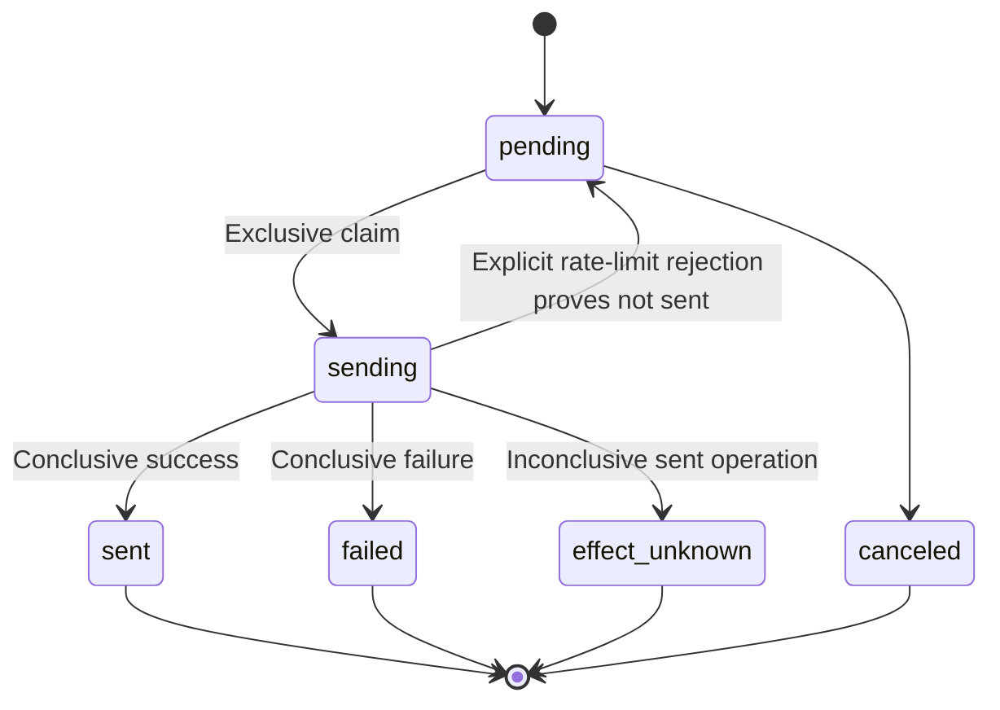
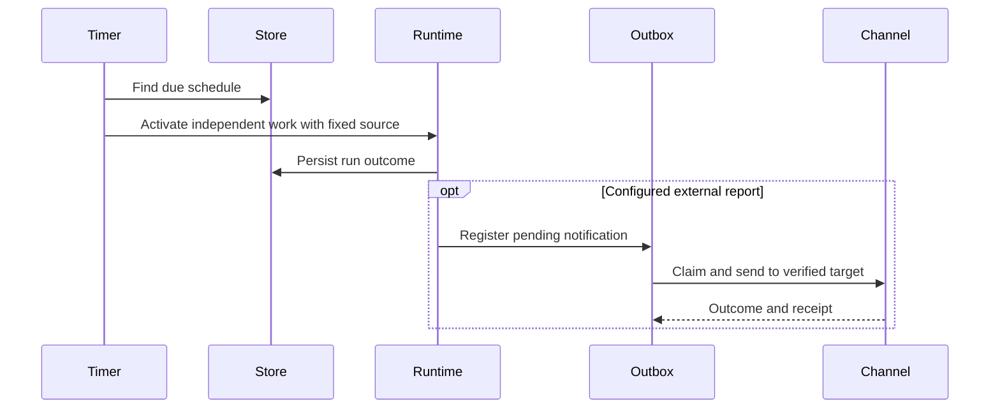

# Scheduling and Notification Outbox

## Responsibilities and Boundaries

Scheduling computes timed rules in fixed IANA time zones and activates independent work. Coding schedules use engineering configuration and retain a development conversation per run. Personal durable schedules manage personal reminders/analysis with their own persisted sources. The notification outbox records external sends and their outcomes.

[Channels](channels.md) owns platform transport; [execution](execution.md) owns command isolation; [runtime](runtime.md) owns shared task/delegation execution.

## Public Interfaces

| Entry | Caller | Purpose |
| --- | --- | --- |
| `CodeScheduler` RPC | Coding clients | Create/query/edit schedules, pause/resume and inspect runs |
| `schedule_create`, `schedule_query`, `schedule_cancel` | Personal model | Manage personal timed work |
| Personal schedule menu | Owner | Guided local management |
| `NotificationOutbox` | Shared runtime | Register, exclusively claim and send fixed notifications |

## Data and State

`code_schedules`/`code_schedule_runs` retain Coding configuration and conversation references. Personal's `ruukoto.schedules` retains its native schedule/run facts. Shared `notification_ops` records fixed destination, content, credentials and outcomes. These are separate product authorities, not one cross-product database.

## Main Flows

Coding Scheduled questions wait in the original run task and return answer/cancel facts through its `ask_user` call with fixed model and permissions. Pending questions determine the waiting label; backend restart interrupts that task and makes unanswered questions stale. Ordinary owner submissions and old-task continuation remain unavailable in an active Scheduled conversation.

Due activation uses an independent conversation rather than contaminating main context. Work runs under its fixed policy and finalizes its resources. Configured reports are sent only after destination eligibility is checked.

## Invariants and Failure Handling

- Exclusive claiming prevents concurrent senders from sending the same record. It does not promise exactly-once delivery across an external network.
- A sent operation with an inconclusive reply becomes `effect_unknown` and is not blindly resent.
- Only explicit rejection proving no send, such as a platform rate limit, allows delayed return to pending.
- Time rules retain their IANA zone. Host timezone changes do not reinterpret the schedule; daylight-saving handling follows the rule implementation.

## Design Rationale

- [Code scheduled](../../.agents/notes/implemented/feature/2026-10-25-code-scheduled.md)
- [Detach terminal from task runtime](../../.agents/notes/implemented/architecture/2026-09-19-detach-terminal-from-task-runtime.md)
- [Same-task owner questions](../../.agents/notes/implemented/feature/2026-10-30-coding-owner-question-wait.md)
