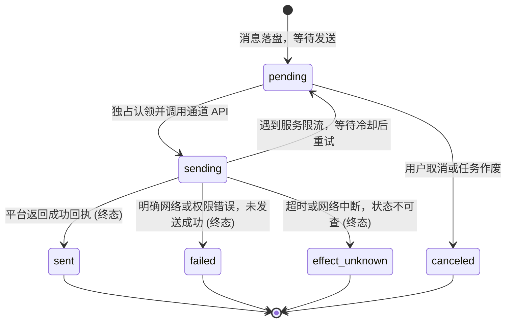
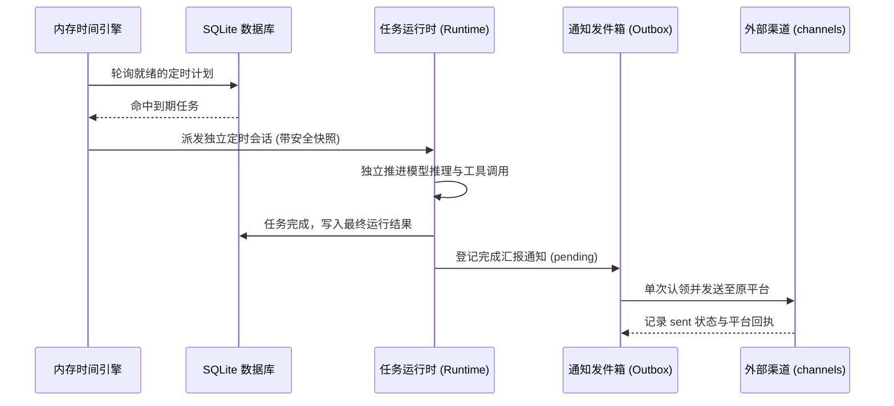

# 调度器与通知 Outbox

## 职责与边界

`scheduler` 模块负责系统的定时规则计算、定时任务协调以及外部通知的发件箱（Outbox）可靠投递。

### 核心职责
- **时间与规则计算（`time.ts`）**：提供基于 IANA 时区的时间规则计算，支持 Cron 表达式、单次延迟与周期性重复触发规则。
- **Coding 定时任务协调**：在 Coding Agent 中配合 Runtime 管理按计划自动执行的工程任务。
- **个人 durable 定时调度**：在个人 Agent 中管理用户的定时备忘、巡检与周期性分析任务。
- **通知 Outbox 账本**：管理所有向外部通道发出的消息任务，提供单次投递、状态追踪与去重保证。

### 边界与非职责
- 外部 IM 通道（QQ / Telegram）的具体连接与协议通信归 [channels](channels.md)。
- 任务执行时的沙箱隔离与进程监督归 [execution](execution.md)。
- 任务在队列中的流转与 SubAgent 编排归 [runtime](runtime.md)。

## 对外接口

| 调用方 / 入口 | 接口名 | 职责与关键契约 |
|---|---|---|
| Coding 客户端 | `CodeScheduler`（RPC） | 增删查改 Coding 自动化定时计划，支持暂停、恢复与历史运行查看 |
| 个人主会话模型 | `schedule_create` / `query` / `cancel` | 个人端模型工具，用于按自然语言意图创建或管理定时任务 |
| 个人终端向导 | 引导菜单「定时计划管理」 | 本机交互式管理向导，提供安全可视化操作 |
| 核心运行时 | `NotificationOutbox` | 提交待发送通知、认领出队并调用外部通道进行精准回传 |

## 数据与状态

### 1. 通知 Outbox 状态流转

外部通知在发出前必须先行落盘入账，状态流转严格遵循确定性保证：

### 2. 存储数据模型

- **`code_schedules` & `code_schedule_runs`**：存储 Coding Agent 的定时规则快照、当前执行状态与关联会话。
- **`ruukoto.schedules`**：存储个人 Agent 的定时计划配置与历史运行事实。
- **`notification_ops`**：存储所有通知发件记录，包含目标通道、内容快照、发送凭据与终态回执。

## 主要流程

### 定时任务全生命周期流程

1. **到期扫描与会话激活**：时间引擎扫描数据库，命中到期计划后为该计划分配独立的运行会话，避免污染主对话上下文。
2. **受限执行与自动收尾**：定时会话在预设的安全模式下运行，执行完成后自动完成步骤汇总与资源清理。
3. **安全通知回传**：若计划配置了结果回传，结果转交 Outbox 引擎，并在核验平台活性后安全投递至指定通道。

## 不变量与失败处理

- **单次投递（At-most-once / Exactly-once）保证**：每条发件记录在发送前获取排他认领锁，同一记录绝不在两个并发线程中重复投递。
- **超时与断线不重发**：发送过程中若遭遇网络超时或未知错误，状态收敛为 `effect_unknown`，绝不盲目重发，防止对用户形成重复骚扰。
- **时区与夏令时一致性**：所有时间规则均固化创建时的 IANA 时区标识，宿主机时区或夏令时调整不破坏原定触发时刻。

## 设计依据

- [Coding 调度的固定配置与独立会话](../../.agents/notes/implemented/feature/2026-10-25-code-scheduled.md)
- [后台任务与终端](../../.agents/notes/implemented/architecture/2026-09-19-detach-terminal-from-task-runtime.md)
