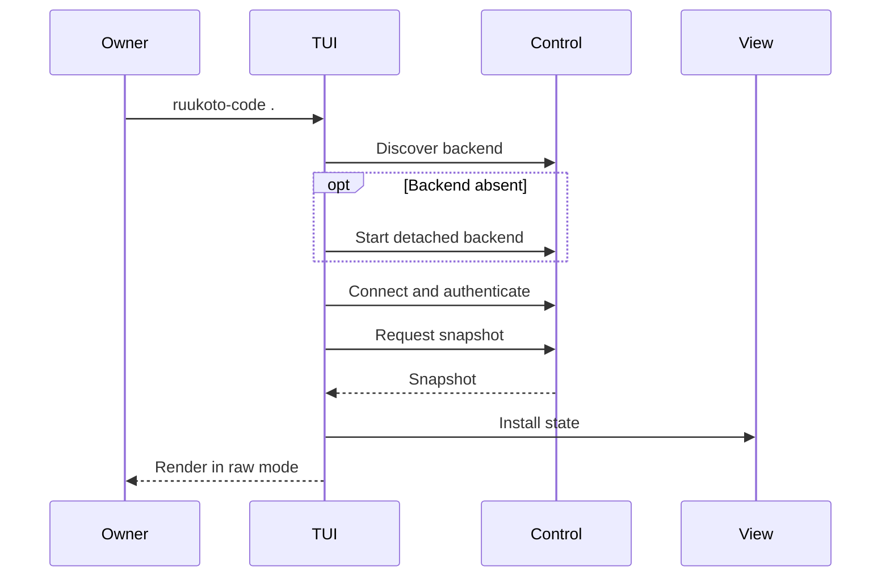

# Terminal UI and Configuration

## Responsibilities and Boundaries

`packages/tui/src/` supplies the full-screen TUI, offline configuration and headless CLI. It renders streamed output, thinking and tool details; dispatches commands; manages raw mode, screen restoration, terminal-safe output and reconnection. [Runtime](runtime.md) owns tasks, [control](control.md) owns transport, and [view](view.md) owns shared projection.

## Public Interfaces

| CLI | Purpose |
| --- | --- |
| `ruukoto-code [path]` | Open a workspace and TUI; start backend on demand |
| `ruukoto-code server` | Foreground backend |
| `ruukoto-code config` | Model, credential and default configuration |
| `ruukoto-code stop` | Graceful backend stop |
| `ruukoto-code status` | Noninteractive backend/task status |
| `ruukoto-code submit <input>` | Submit a new task to a selected conversation and return its ID |
| `ruukoto-code resume-queue <session> [--stop-confirmed]` | Resume dispatch; use the flag only after verifying old retained execution has stopped |
| `ruukoto-code mcp cua` | Open computer selection/recovery in configuration |

Online MCP settings are instance-wide across workspaces. The owner chooses allowed tools and read/write/unknown effects; newly allowed tools default to unknown. Personal remote services, credential rebinding and original-call finalization use [desktop management](desktop.md#mcp-call-finalization-and-computer-recovery) or the [Personal CLI](personal-durable.md).

| TUI command | Behavior |
| --- | --- |
| `/mode` | Choose the conversation's run mode |
| `/model` | Select a conversation model |
| `/todo` | Toggle the work checklist overlay |
| `/interrupt` / `/cancel` | Interrupt execution / cancel the task |
| `/resume-queue` | Resume dispatch; retained occupancy opens a separate stop-confirmation interaction |
| `/queue` | Inspect, reorder or retrieve any eligible ordinary queued input, or turn it into guidance |
| `/steer <text>` | Inject guidance at the target's next boundary; return to queue head if missed |
| `/recall [verify]` | Recall the latest input into the draft; the queue stays paused if stopping is unverified, and `verify` rechecks the original request |
| `/detach` | Remove attachments restored into the draft by recall |
| `/side` | Toggle tool-free side chat from its first-open frozen snapshot; Esc hides it without losing draft/generation; its `/interrupt` affects only side chat |

## Data and State

The terminal shows conversation/workspace identity and mode at the top, the shared event timeline in the body, an input area, and model/usage statistics. Overlays retain the main screen; full windows replace it. Resizing recalculates layout without changing backend task state.

| Computer-recovery state | Available action |
| --- | --- |
| Original execution unverified | Inspect original operation and verify stopping |
| Original execution stopped | Inspect/recover to obtain a new image |
| Fresh observation available | Open or reread its screenshot |
| Current full image opened successfully | Accept the viewed observation and allow new work |

## Main Flows

Queue retrieval saves the original request key before sending, verifies lost responses through its receipt, and restores text/attachments into the initiating draft. `/recall` remains historical recall. `/questions` answers, skips or cancels within the original task; closing the window leaves it waiting. Ordinary post-interrupt drafts create new tasks; CLI `continue` and TUI `/continue` are removed, while old pending records remain verification-only in their original instance.

On-demand backend logs go to `<controlDir>/spawn.log`. The client listens for keyboard and `SIGWINCH`, then restores cursor, alternate screen and input mode on exit.

Computer recovery starts from the original operation in MCP settings. Verify it stopped, enable the original computer service before observation, obtain and open a new screenshot, then accept that observation. The separate begin-recovery menu is retired; existing recovery-started records continue with observation. Fetching a replacement image clears old acceptance eligibility first.

## Invariants and Failure Handling

- TUI exit, terminal closure and client disconnection do not stop backend work. `ruukoto-code stop` explicitly stops the service.
- Model/tool text is filtered before terminal rendering to prevent control-sequence injection.
- A disconnected client shows reconnection state and retries with backoff, then recovers its view.
- Failed screenshot opening does not offer acceptance. Recovery allows new work but leaves the original unknown operation unchanged.
- A `run_steps` computer batch approval binds every step: the detail overlay lists the ordered actions, scrolls when content overflows, and refuses approval until all parameter pages have been read through and the content scrolled to the end.

## Design Rationale

- [Detach terminal from task runtime](../../.agents/notes/implemented/architecture/2026-09-19-detach-terminal-from-task-runtime.md)
- [Shared history recovery](../../.agents/notes/implemented/architecture/2026-10-23-shared-history-recovery.md)
- [In repo workspace packages](../../.agents/notes/implemented/architecture/2026-10-11-in-repo-workspace-packages.md)
- [Mcp host responsibilities](../../.agents/notes/implemented/simplification/2026-10-26-mcp-host-responsibilities.md)
- [Coding user queue](../../.agents/notes/implemented/feature/2026-10-30-coding-user-queue.md)
- [Same-task owner questions](../../.agents/notes/implemented/feature/2026-10-30-coding-owner-question-wait.md)
