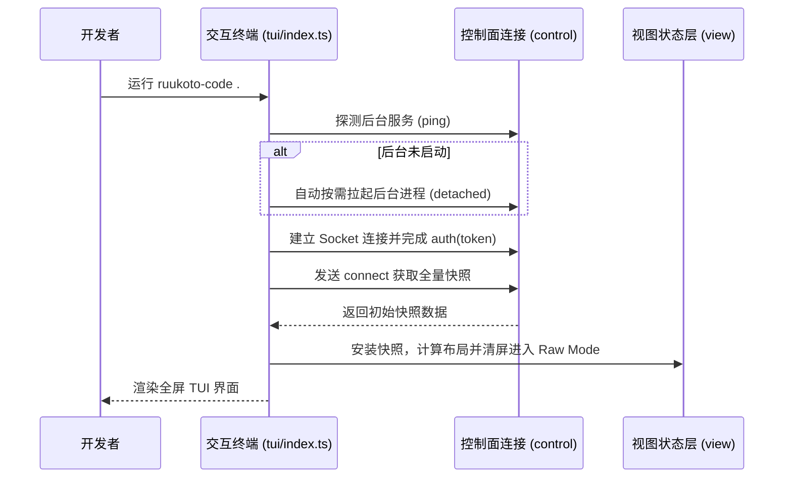

# 交互终端与配置中心

## 职责与边界

`tui` 模块（对应 `packages/tui/src/`）提供全屏终端交互界面（TUI）、离线配置中心与无头命令行工具集（CLI）。

### 核心职责
- **全屏交互终端（TUI）**：为开发者提供沉浸式的终端全屏开发界面，实时流式渲染大模型输出、思考过程、工具调用细节与 Diff 统计。
- **命令行工具分发（CLI）**：提供 `status`、`submit`、`events`、`cancel` 等命令行子命令，便于在自动化脚本或无 TTY 环境中操控后台。
- **交互式离线配置中心（`config-tui`）**：通过 `ruukoto-code config` 提供全屏图形化配置界面，无需启动后台服务即可安全编辑模型与 API Key。
- **终端安全与生命周期管理**：负责终端 Raw Mode 的开启与恢复、ANSI 控制字符转义与防注入过滤，以及断线自动退避重连。

### 边界与非职责
- 任务的状态机流转与执行画像计算归 [runtime](runtime.md)。
- 底层 Unix Socket 通信协议与事件序列归 [control](control.md)。
- 内存状态投影与增量对齐算法归 [view](view.md)。

## 对外接口

### 1. 核心 CLI 命令

| 命令格式 | 核心用途与参数说明 |
|---|---|
| `ruukoto-code [路径]` | 打开指定代码目录并启动全屏 TUI，后台未运行时自动按需拉起服务 |
| `ruukoto-code server` | 前台运行 Coding 后台服务进程，托管数据目录与控制面 Socket |
| `ruukoto-code config` | 打开全屏终端配置中心，管理模型、凭据与默认参数 |
| `ruukoto-code stop` | 优雅停止当前数据目录下运行的后台服务 |
| `ruukoto-code status` | 非交互式查询当前服务健康状态、正在运行的任务与系统负载 |
| `ruukoto-code submit <输入>` | 命令行向指定会话提交一次性任务，返回任务 ID |
| `ruukoto-code mcp cua` | 打开配置中心，从 MCP 服务选择本机电脑与人工恢复 |

在线配置中心的“MCP 服务”管理实例服务、允许工具与本地效果类别，各工作区共用同一配置。普通工具的允许与只读、写入、副作用不明由拥有者选择；新允许项默认副作用不明。个人 Agent 的远端服务、凭据重绑与原调用人工结束由[桌面客户端](desktop.md#mcp-原调用收尾与电脑恢复)或其[原生管理入口](personal-durable.md)提供。

### 2. TUI 内置快捷命令 (Slash Commands)

在全屏 TUI 底部输入框中，用户可随时输入以下快捷指令：

| 指令 | 效果与行为 |
|---|---|
| `/mode [normal \| review \| plan]` | 切换当前会话的权限模式（受限审查 vs 计划模式 vs 完全访问） |
| `/model` | 弹出会话级模型切换选择菜单 |
| `/todo` | 呼出或收起当前工作清单与待办事项悬浮抽屉 |
| `/interrupt` | 中断当前正在执行的模型流式输出或工具调用 |
| `/cancel` | 主动取消当前任务，收敛至 `canceled` 终态 |
| `/resume-queue` | 恢复因异常中断而暂停的会话排队队列 |
| `/queue` | 查看排队输入，逐项上移/下移或转为引导 |
| `/steer <正文>` | 把正文作为引导接入当前任务的下一边界，错过目标回队首 |
| `/side` | 打开/收起当前会话的无工具侧聊悬浮层：固定首次打开的历史快照，Esc 收起保留草稿与生成，层内 `/interrupt` 只中断侧聊 |

## 数据与状态

### 终端全屏布局架构

```
┌────────────────────────────────────────────────────────────────────────┐
│ [Project: my-app]  Session: dev-01  Mode: Review (native)  Status: ● │  <- 顶栏状态
├────────────────────────────────────────────────────────────────────────┤
│ User: 请帮我重构 auth.ts 并补充测试                                    │
│                                                                        │
│ 💭 思考中: 分析代码依赖关系...                                          │
│ 🛠️ 工具调用: read packages/auth/src/index.ts (ok)                     │
│ 📝 代码修改: edit packages/auth/src/index.ts (+12, -4)                │
│                                                                        │
│ Assistant: 我已完成核心重构，并修复了潜在的 Token 泄露问题。            │
├────────────────────────────────────────────────────────────────────────┤
│ [Workspace: /Users/dev/code/my-app]                                    │
│ > 输入你的指令... (Enter 发送, Shift+Enter 换行, / 查看命令)            │  <- 输入框
├────────────────────────────────────────────────────────────────────────┤
│ Tokens: 12.4k / 128k (9.6%) │ Model: Claude 3.7 Sonnet │ Effort: High  │  <- 底栏统计
└────────────────────────────────────────────────────────────────────────┘
```

电脑恢复菜单围绕当前原动作与新观察组织：

| 状态 | 可选动作 |
|---|---|
| 原执行待核实 | 查看原动作、核实原执行停止 |
| 原执行已停止 | 检查并恢复，取得新截图 |
| 已取得新观察 | 打开当前新截图、重新读取恢复截图 |
| 当前新图已成功打开 | 接受已查看的新截图，开放新工作 |

## 主要流程

### 客户端启动与渲染时序



1. **按需探测与静默拉起**：检测本地 Socket 活性；若后台尚未运行，自动启动子进程并输出日志至 `<controlDir>/spawn.log`。
2. **终端环境初始化**：进入 Raw Mode，监听键盘事件与窗口大小变化（`SIGWINCH`），动态适配不同尺寸的终端屏幕。
3. **安全退出与现场还原**：退出时恢复光标显示、退出 Alternate Screen 缓冲区并还原终端原始输入模式。

### 电脑恢复

1. 在“MCP 服务”的“电脑状态与恢复”查看原动作，核实原执行停止；恢复取图前启用原电脑服务。
2. 选择“检查并恢复”取得新截图，再打开当前新图。独立开始恢复菜单已退役，已有开始恢复记录可继续取图。
3. 完整新图成功打开后，确认接受此观察；重新取图会先清除旧图的接受资格。

## 不变量与失败处理

- **界面退出与后台执行解耦**：终端 TUI 仅为纯观察与交互端。退出 TUI、关闭终端窗口或网络断开绝不影响后台正在执行的任务，显式执行 `ruukoto-code stop` 才会停止服务。
- **输出内容防终端注入**：从模型输出或工具执行结果中读取的文本，在终端渲染前统一经过严格过滤，剥离潜在的恶意 ANSI 控制转义序列，防止破坏终端布局或执行恶意逃逸命令。
- **自动断线退避重连**：后台重启或临时断网时，TUI 显示醒目的重连状态条并以指数退避算法自动尝试重连，重连成功后平滑恢复视图。
- **恢复绑定当前新图**：原截图打开失败时不提供接受动作；接受后开放新工作，原未知动作保持原记录。

## 设计依据

- [后台任务与终端](../../.agents/notes/implemented/architecture/2026-09-19-detach-terminal-from-task-runtime.md)
- [双端共用会话历史恢复](../../.agents/notes/implemented/architecture/2026-10-23-shared-history-recovery.md)
- [同仓 workspaces 分包](../../.agents/notes/implemented/architecture/2026-10-11-in-repo-workspace-packages.md)
- [MCP 宿主职责收缩](../../.agents/notes/implemented/simplification/2026-10-26-mcp-host-responsibilities.md)：合并电脑恢复交互，保留停止核实与当前新图接受。
