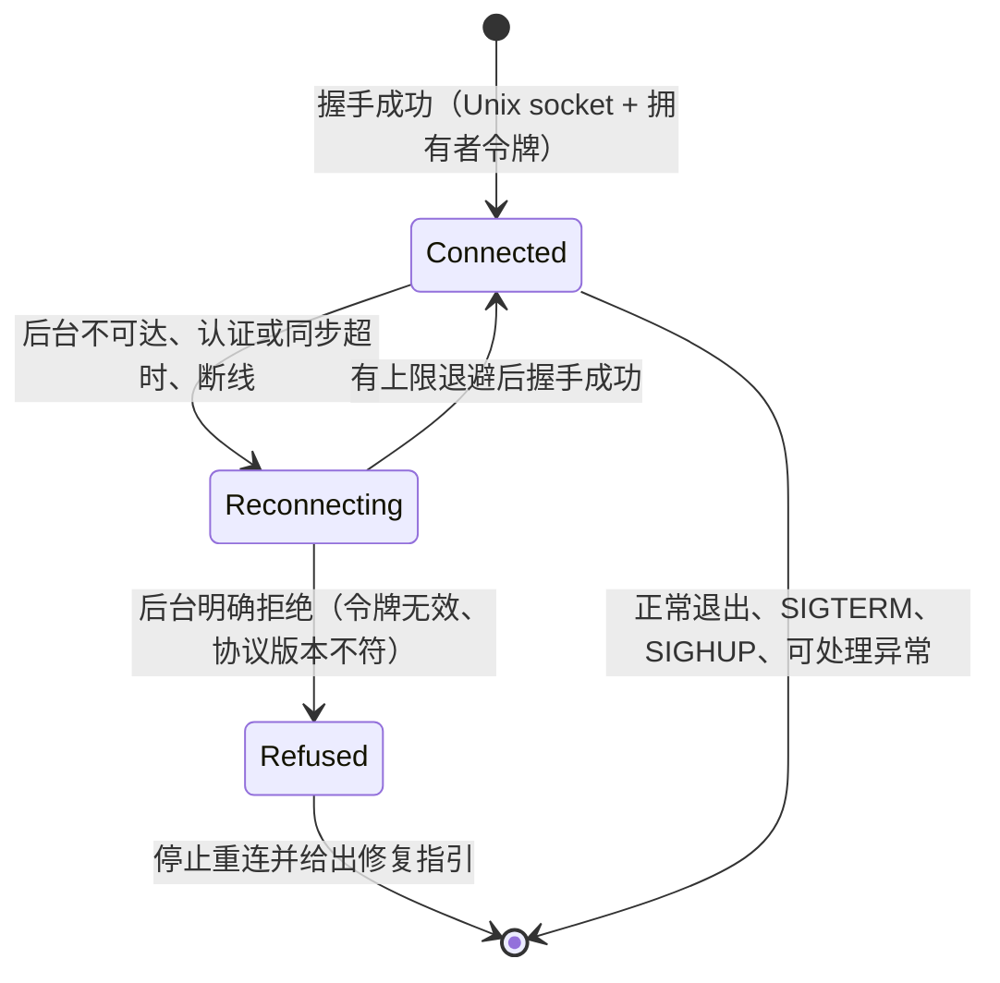
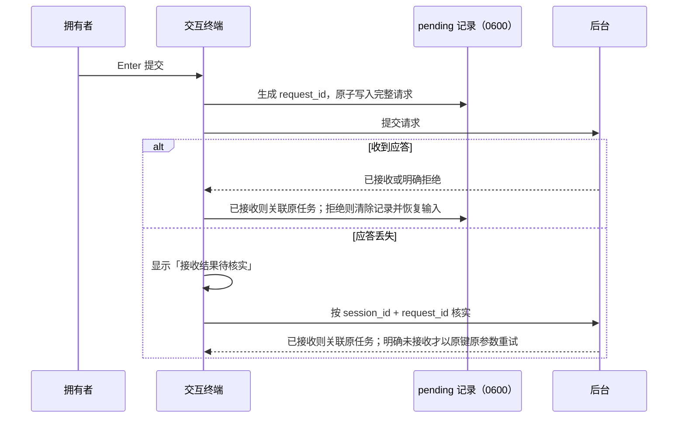

# 共享 CLI、交互终端与配置中心

## 职责与边界

共享 CLI（`packages/tui/src/cli.ts`，顶层分发在 `cli-entry.ts`）是两个产品的唯一命令入口：按 app 传入的产品声明分发任务界面、工作区、配置中心与后台启动，`server` 在本进程装配运行时，`packages/tui/src/index.ts` 另提供程序化聚合入口。开发启动器（`packages/tui/src/dev.ts`）只服务于开发本项目。命令清单与参数见[操作手册](../usage.md)，开发启动器的行为见[开发说明](../development.md#开发实例)，本篇不重复。

交互终端（`packages/tui/src/tui/`）与配置中心（`packages/tui/src/config-tui/`）是后台的两个拥有者入口，共用控制面拥有者认证与 TUI 组件。交互终端是全屏交互页面：顶部一行显示项目、会话、工作目录、连接状态、任务权限模式与执行后端，中间滚动显示消息与工具记录，输入框上横线右侧显示工作区目录名，底栏显示权限模式、token 用量与模型选择；工作清单经 `/todo` 悬浮层查看。配置中心经 `ruukoto config` 打开独立配置界面，不直接打开核心数据库，也不成为绕过任务审批的入口——任务执行审批仍在任务界面。

交互终端负责：

- 只经本机 Unix socket 加拥有者令牌连接后台，不创建 SDK 会话、不加载模型凭据、不直接读取后台数据库或 JSONL。ruukoto 只连接已运行的后台；ruukoto-code 在连接前按需拉起本机后台，拉起规则是产品入口行为，归[操作手册](../usage.md)与[架构总览](../architecture.md)。
- 采集拥有者输入，生成提交请求并处理请求去重，维护客户端私有的输入历史、命令回显与待核实记录。
- 渲染事件流：用户输入、工具记录、模型正文、思考段与任务状态，含工具结果展开、Edit/Write 增删行统计与 Mermaid 代码块转换。
- 维护连接生命周期：断线后按有上限的退避重连，从后台重建快照、历史与任务事件。
- 终端安全：渲染前剥离终端控制序列。
- 退出与终端恢复：关闭 socket，恢复 raw mode、光标与屏幕。
- 配置中心的在线管理范围与有限离线模式。

不负责的部分点名归属：

- 任务的排队、执行、状态迁移与收尾归 [runtime](runtime.md)。退出或断开只关闭客户端，后台任务继续执行；终端不发送 `stop`、不取消任务。
- 项目与工作区的归属判定、根目录列、旧数据组织迁移的预览与计划校验归 [runtime](runtime.md)，迁移命令只在[操作手册](../usage.md)出现。本篇只写工作区入口在终端侧的行为与列表、标题、详情怎样展示归属。
- 审批闸门、权限版本与工作清单工具的写入语义归 [agent-tools](agent-tools.md)；本篇只写审批等待与工作清单在界面上的呈现。
- 非 TTY 环境不启动交互页面，改用 `status`/`events`/`submit` 等 CLI 命令；远程使用沿用登录服务器后启动 TUI 的方式，不新增远程协议。

## 对外接口

后台入口按 app 的 `CliProduct.defaultExecution` 与 `allowedExecution` 校验执行后端：Coding Agent 默认且仅允许 native，个人 Agent 保留 local/container。任务 TUI 在连接已有后台前也校验环境覆盖。开发启动器与按需后台复用所属 app 的 bin，使用同一声明；库层 local 注入不经 CLI 限制。

交互终端是控制面的客户端。它调用的操作：

| 操作 | 用途 |
|---|---|
| `open_workspace` | 以目录为工作区打开：复用已确认归属的工作区，或认领旧项目根目录，或创建新工作区项目 |
| `create_project` / `create_session` | 创建项目与会话；不写根目录归属，旧项目与旧会话照常可读 |
| `branch_session` / `find_branch_session` / `get_session_todos` | 创建历史分支、按原请求键核实结果、恢复完整历史中的工作清单 |
| `list_session_summaries` | 列出会话摘要，`project_id` 与 `workspace_id` 互斥 |
| `read_history` / `read_history_entry` | 按会话分页与分段读取消息历史 |
| `list_tasks` / `find_task` / `get_task` | 已结束任务分页、按 `session_id + request_id` 核实请求、取任务快照 |
| `read_task_events` | 按 `task_id`、`after_seq`、`limit` 分页恢复持久任务事件 |
| `get_confirmation_params` / `get_tool_op_params` | 按 ID 分段读取大参数 |
| `respond_confirmation` | 提交审批决定，可携带 `permission_version` |
| `read_artifact` | 按字节分页读取产物正文，单次上限 720 KiB（base64 开销后仍在 1 MiB 帧上限内） |
| `get_model_config` / `set_summary_model` | 读取模型配置（`get_model_config` 返回 `summaryModel`）、设置摘要模型 |

控制面事件：`project.root_attached`、`project.settings_changed`、`task.output_fragment`、`task.output_entry`、`task.thinking`、`task.tool_result` 及任务状态迁移事件。终端也调用任务操作（`/interrupt`、`/cancel <taskId>`、`/continue [taskId]`、`/resume-queue`、`/mode`、`/model`、`/skill`）。

协议与载荷约定：

- `task.output_fragment` 携带消息 ID、正文段 `contentIndex`、UTF-8 字节偏移 `offset` 与该段 `startedAt`，单片有界，接收端按偏移拼接完整正文；缺少偏移的片段按累计尾部解释。
- `task.thinking` 携带思考段 ID、开始与结束时间及单行展示所需的最新内容。
- `task.tool_result` 可携带真实 `editStats`。
- 消息完成后仍以 `task.output_entry` 关联的 JSONL 正文为准，事件投影不替代会话历史。
- `get_task` 返回快照对应的事件序号 `seq`，客户端据此协调实时事件与详情恢复。
- 握手返回数据实例标识与执行后端说明，native 在同一字段展示原生沙箱；协议版本不同的客户端与后台在握手时明确拒绝，持久事件中的旧格式兼容不代表线上协议向后兼容。
- 快照有界（活动任务加每会话近期结束任务）；工具大参数、快照输出预览与事件分页均有载荷上限。
- 拥有者令牌文件路径可经 `RUUKOTO_OWNER_TOKEN_FILE` 指定，用于拥有者与后台不同 UID 的部署。
- `respond_confirmation` 携带的 `permission_version` 不匹配时返回 `permission_version_mismatch`。
- `request_id` 由客户端保存，唯一范围为会话：同键同参数（含模式与授权范围）重试返回原任务，同键异参返回 `request_conflict`。

输入接口的按键映射：

| 按键 | 行为 |
|---|---|
| `Enter` | 提交 |
| `Alt+Enter`、`Shift+Enter`、`Ctrl+J` | 换行 |
| 上下键 | 调出输入历史 |
| `Shift+Tab` | 输入框聚焦时循环切换后续任务的默认模式 |
| `q` / `Esc` | 关闭选择与查看的悬浮层或窗口 |
| `Ctrl+C` | 空草稿时退出客户端 |

斜杠命令以 `packages/tui/src/tui/commands.ts` 的条目表为准：补全、`/help`、派发、回显、是否作为任务输入与是否保留成功结果都由条目推出。补全只覆盖 `/` 固定命令，不扫描本地文件。

| 命令 | 行为 |
|---|---|
| `/resume` | 切换当前项目中的会话 |
| `/project` | 切换项目；ruukoto-code 为工作区/旧项目列表 |
| `/new-project`、`/new-session <目录>` | 创建项目或会话 |
| `/branch [名称]` | Coding Agent 建立独立历史会话，安装完整后台设置后自动切换 |
| `/artifact <id 前缀>` | 按字节分页查看产物正文 |
| `/approvals` | 待处理审批，详情内 `a` 批准、`r` 拒绝，Esc/q 关闭不等于拒绝 |
| `/interrupt`、`/cancel <taskId>`、`/continue [taskId]`、`/resume-queue` | 明确的任务操作 |
| `/mode` | 通过列表设置会话默认模式，作用于后续任务 |
| `/model` | 选择后续任务的模型和思考档位 |
| `/skill <名称> [参数]`、`/skills` | 显式调用技能、查看技能库与诊断 |
| `/todo` | 打开或关闭工作清单悬浮层 |
| `/context` | 命令下保留 `⎿ Context Usage`、分色上下文长条与分类数据 |
| `/prompt`、`/search`、`/memory`、`/qq` | 正常内容在可关闭的窗口中展示 |
| `/quit` | 退出客户端，不记录命令行 |

终端调用的本地文件：`~/.ruukoto/pending/`（`RUUKOTO_PENDING_DIR` 可覆盖）、`~/.ruukoto/tui/commands.sqlite`、`<agentDir>/auth.json`、`<agentDir>/default-model.json`、`<agentDir>/summary-model.json`、`<agentDir>/credentials.json`、`<agentDir>/config.lock/`。

## 数据与状态

终端自身的持久状态只有三处：待发送请求的记录、命令行的私有记录、`--demo` 的待核实记录。会话内容、任务与工作清单都不是终端状态，它们从后台读取。

**连接状态**：

连接状态显示在顶部一行；重连不会悄悄另起同一任务。

**待发送请求记录**：提交前生成 `request_id`，把完整请求原子保存到拥有者私有目录（默认 `~/.ruukoto/pending/`，`RUUKOTO_PENDING_DIR` 可覆盖，权限 0600）。记录绑定数据实例标识，换新数据库后不会向空后台重发。未发送或后台明确拒绝时清除记录并恢复输入。

**命令行私有记录**：当前会话的命令行及其结果保存到 `tui/commands.sqlite`（位于待确认请求目录的同级目录，默认 `~/.ruukoto/tui/commands.sqlite`；dev 沿用独立 profile）。记录按数据实例和会话隔离，退出后重新进入会话仍按原时间显示，恢复记录不会再次执行命令；`/quit` 不记录。

**配置中心状态**：模型配置以 `expected_revision` 标示，它是 models.json、auth.json、default-model.json 与 summary-model.json 的内容指纹；项目、会话、MCP、QQ 沿用各自的 `expected_version`。项目指令与 Web Search 共用 `projects.settings_version`（只保护这两项，不与 MCP/Jev/会话默认各自的版本列合并），旧项目初始版本为 1。后台默认模型保存为 `<agentDir>/default-model.json`，摘要模型保存为 `<agentDir>/summary-model.json`（形如 `{provider, modelId}`，不存思考档位）；显式启动参数 `--model` 优先于默认模型文件。模型 API key 在 auth.json，服务凭据在 credentials.json，分开管理。离线模式的互斥按规范化 agentDir 的配置锁 `<agentDir>/config.lock/` 判定；后台运行时持有该锁（不同 dataDir 共用 agentDir 也被覆盖）。

**界面状态**：草稿、输入历史、当前选择的模式/模型/思考档位保存在客户端内存中。切换普通开发会话时沿用切换前选择的模式（含 Plan）、模型和思考档位，并保存为目标会话的默认设置；提交新任务会等待设置保存完成，已有任务继续使用创建时的设置。切换保留草稿；连续按键依次保存，后台确认后更新显示。

**工作清单的来源**：普通会话取已加载工具记录中最近一次成功 `todo_write` 的参数；分支从后台完整历史中的配对请求参数恢复，后续成功调用覆盖它，重连后按同一来源恢复。后台视图未到齐时暂用已加载工具记录，分支不需要复制原工具账本。

**工作区项目数据**：工作区项目带根目录归属列 `root_cwd` / `root_real` / `root_dev` / `root_ino`，同一真实目录至多一个工作区，由部分唯一索引兜底；列的含义、写入与认领条件由 [runtime](runtime.md) 维护。终端只读取归属结果，用于列表分类、标题标注与根目录展示。

## 主要流程

分支命令先保存请求键，结果未知时按原键查询；退出重进可恢复待核实记录。完整后台会话安装后，只有发起客户端自动切换，编辑器为空，目标继承设置不经跨会话设置传播覆盖；其他客户端只更新列表。失败保留来源选择和草稿，命令及结果留在发起会话的命令历史。会话列表优先展示持久名称，首个任务不覆盖分支名称。来源和实际分支点在新会话中可见；产物查看包含限定来源，工作清单由后台完整历史恢复。

**启动与连接**：解析入口参数（`ruukoto <路径>`、`ruukoto --session <id>`、`--demo`；拼作 `ruukoto tui` 时给出迁移指引并沿用同一行为），建立到本机后台的连接并握手。后台不可达（含启动时后台尚未就绪）、认证或同步超时、断线时显示连接状态并按有上限的退避重连；只有后台明确拒绝（令牌无效、协议版本不符）才停止重连并给出修复指引。

**`--demo` 合成调试会话**：不连后台，只应答展示所需的读操作，其余操作明确拒绝（提交恢复草稿），待核实记录写到临时目录。

**工作区入口**：`ruukoto <路径>` 以该目录为工作区创建新会话并直接进入。`./config` 与 `-- <路径>` 用于处理与命令同名的目录；相对路径按客户端调用时的工作目录解析。请求经 `open_workspace` 发出：已确认归属的工作区直接复用；尚未归属的旧项目作为候选，经选择列表确认后认领根目录（多个候选先选择，取消则不创建任何记录，`project.root_attached` 事件留痕）；从未使用的目录自动创建工作区项目。认领或建项目与建会话在同一事务，失败不留空项目。后台继续校验目录存在性、realpath、dev/ino、保护根与权限，只接受已有目录；归属判定按真实目录身份，同名不同目录各自成工作区（项目名仅展示层去重，重名追加序号，绝不合并）。角色或群聊会话所在的项目（含混合旧项目），以及会话分布在多个真实目录的旧项目，都不可经目录入口认领；后者的机制与命令归 [runtime](runtime.md) 的旧数据组织迁移与[操作手册](../usage.md)。每次独立启动创建一个新会话；创建请求带稳定启动请求标识（`open_workspace` / `create_project` / `create_session` 幂等键），断线重连后按标识在新快照中核实，不重复创建；连接仍在的应答丢失当场核实一次，仍未确认则回到正常启动并提示用 `/project` 查看。

**提交与请求去重**：

**历史与滚动**：滚动到顶部自动加载更早历史，保留当前查看位置；加载中不重复请求，已加载的更早历史不会被初始 300 条限制裁掉。向上或向下滚动查看历史时，顶部事件所属任务的用户消息完整滚出视野后固定显示在事件流顶部；跨任务时切换，恢复跟随末尾时隐藏。置顶消息保留灰底，最多显示三行，超出部分用省略号标记，并在滚动区域内覆盖显示，切换时不改变视口高度。

**事件流渲染**：用户输入、工具、模型正文、思考段和任务状态按发生顺序展示，独立事件之间空一行，工具或命令与其结果紧贴。用户消息与命令消息使用铺满内容行的灰色背景，命令结果单独显示。首列保留给 `❯`、`●` 等图标；工具图标为 `●`，成功为绿色、失败为红色。Markdown 正文、列表、代码块与续行统一缩进。工具只展示名称和主要目标，Read、Write、Edit 的文件目标按会话工作区显示相对路径，错误另行提示；Edit 与 Write 的真实成功增删行数分别显示为绿色和红色，缺失统计时省略；长 Bash 命令从尾部截断并以 `...` 结尾；`todo_write` 只显示完成数/总数（如 `⎿ 3/7`），不展开清单；事件流末尾保留一行空位。

**工具结果展开**：点击工具返回结果行在事件流中展开，再次点击收起，保持输入焦点，不创建悬浮层或窗口。Write 显示带行号的写入原文和语法高亮，不显示 diff 标记；Edit 显示带实际行号的修改，保留语法高亮，删除用红色背景、新增用绿色背景，不显示补丁头或代码围栏；其他工具显示保存的结果正文。展开内容最多 8 KiB、80 行；Write 省略内容时在末尾显示 `...n more lines`，行数根据完整写入原文计算。结果和 Edit 补丁来自 JSONL，Write 原文来自对应工具调用。

**Mermaid 渲染**：助手消息中的 `mermaid` 代码块在生成完成后转换为 Unicode 字符图（beautiful-mermaid），支持中文标签。流式生成期间显示源码。终端宽度变化时重新排版。以下情形保留源码：

| 情形 | 判据 |
|---|---|
| 解析失败 | 无法解析为受支持的图 |
| 图形超过可用宽度 | 超出当前终端可用宽度 |
| 图形过大 | 超过 8192 字符或 100 行 |
| 组合字符无法对齐 | 渲染库无法对齐的组合字符 |
| 方向不正确 | 当前渲染库方向不正确的 `RL` 图 |

支持范围以渲染库为准，不保证完整 Mermaid 语法兼容。

**思考与正文**：每段思考显示点状旋转图标与 `Thinking...`，公开思考内容多行滚动展示最新四行，使用灰体，点击后在事件流展开完整内容，再次点击收起。结束后标题原位显示 `Thought for Ns` 并保留内容；有明确思考阶段事件时按该阶段计时。没有公开思考时，从每轮请求发出到正文或工具调用开始计时，包含网络等待。正文完整流式保留，可向上滚动，不受 8 KiB 尾部预览限制。

**输入编辑**：输入框随显示内容自动增高，事件流让出相应空间，保留上下横线；超过编辑器可见行上限后在框内滚动，光标所在行保持可见，清空后恢复最小高度。上横线右侧显示工作区目录名，宽度不足时截断；底栏不显示工作区路径。输入支持中文与 bracketed paste，大段粘贴在编辑器内折叠显示，草稿与提交保留展开后的原文。

**历史恢复**：普通消息与斜杠命令统一进入输入历史，可用上下键调出；重新进入会话时按时间顺序恢复已保存的用户消息和命令，调出历史不会执行命令。

**用量显示**：底栏在模型名左侧以灰体显示当前会话累计实际用量，如 `↑114K ↓514 · Provider/Model · Effort`。输入包含缓存读取、写入的 token；输出取 provider 实际输出，用量缺失的调用不计入，不使用估算。数量按千进制转换为 K、M、B，最多一位小数；宽度不足以显示统计和完整模型信息时，整段统计隐藏。每次实际用量保存后更新，切换会话及重连时从后台恢复累计值。

**会话与项目选择列表**：会话选择列表每项两行——首行优先使用持久名称，其余使用最早用户输入（无输入时显示未命名会话），次行显示距最后任务活跃时间的间隔（如 `2 hours ago`），没有任务时从创建时间计算；会话之间留一行空白；名称过长时截断，选中任意一行都进入对应会话。项目选择列表采用相同布局：首行显示 `项目名 · 会话数`，次行显示会话的工作区路径，多个工作区去重后在同一行展示，没有会话时显示「尚无工作区」，项目之间空一行。

**选择面板（ruukoto-code）**：工作区列在前（带根目录归属），旧项目列在后；逻辑角色（main/coding/chat）与 QQ 群聊会话所在的项目不进入普通列表，会话列表同样过滤。内部子任务是任务而非会话，不出现在会话列表。ruukoto 产品的列表不变，主会话等照常列出。工作区查阅与新建按组织归属：`list_session_summaries` 的 `workspace_id` 参数做组织归属查询（活动时间算法不变，映射事件不算任务活跃），选择面板计数与会话列表、恢复旧会话后的当前选择状态、`/resume` 默认项都按组织归属，ruukoto 产品与旧 API 恒按原身份。会话标题对已映射会话标注「工作区（配置与资料来源：来源项目）」；从已映射旧会话经 `/new` 或 `/new-session` 创建的新会话落到目标工作区（目标 Project ID 与配置），无映射旧会话保持原行为。

**模式与模型切换**：`Shift+Tab` 在输入框获得焦点时按 Ask for approval → Full access → Auto review → Plan 循环切换普通开发会话后续任务的默认模式；其他适用会话只显示访问模式选项。窗口与选择悬浮层打开时不触发该快捷键。`/mode` 通过列表设置会话默认模式，`/model` 选择后续任务的模型和思考档位。

**悬浮层与窗口**：悬浮层简单覆盖下层内容，打开时保留主界面可见；`/mode`、`/model` 的选择内容与斜杠补全以悬浮层展示；`/todo` 在右上角显示带完整边框的工作清单悬浮层，保留输入焦点，再次输入 `/todo` 或按 Esc 关闭。窗口四周有完整边框，打开时隐藏主界面的顶部、事件流、工作清单、输入框与底栏；`/help`、`/resume`、`/project`、`/prompt` 的内容以及其他需要隐藏主界面的详情、查询结果、提示与确认均以窗口展示；多层窗口只显示最上层，关闭后逐级恢复。选择和查看的悬浮层与窗口均可用 `q` 或 `Esc` 关闭。

**工作清单悬浮层**：经 `/todo` 查看当前会话的完整清单，`▶` 进行中、`⏸` 待做、`✓` 已完成（暗色），保留所有条目，长任务名单行截断，超出高度时可在悬浮层内用鼠标滚轮查看。清单更新后实时刷新；没有清单时显示说明；全部完成时仍可查看。窗口打开时暂时隐藏，关闭窗口后恢复。

**命令结果**：命令在当前客户端回显（`/skill <名称> [参数]` 作为任务输入提交，只显示任务输入一行）；`/mode` 和 `/model` 追加 `⎿ Switched to ...`；`/prompt`、`/search`、`/memory`、`/qq` 等命令的正常内容在可关闭的窗口中展示，关闭后只留下命令行；错误和必要警示仍明确提示。`/prompt` 详情完整读取快照并解析为文本，按系统提示、消息角色与工具定义分区，多行正文直接显示；工具参数按层级展示，图片只显示类型；使用方向键或翻页键滚动查看，Esc/q 返回请求列表；快照损坏时显示解析错误，不显示 JSON 原文。上下文长条按当前终端可用宽度重新分配各颜色段，缩窄时保持单行；分类、预留与余量的 token 数统一使用小写 k/m（最小 k、最大 m），百分比保持原口径。

**任务状态显示**：执行期间同时显示底部 `● Sweeping · Elapsed Ns`，`Sweeping` 文字有从绿到白再回绿的移动流光；审批等待另加文字标注。总耗时从实际开始执行算起，包含审批等待、不含排队。存在非空工作清单时，在 Elapsed 耗时后追加 `[完成数/总数]`，如 `Elapsed 42s [1/5]`。成功为灰体 `  Done in Ns · At Tue 09:16 PM`，失败为红色 `✗ Failed`，取消或中断为黄色 `Canceled`、`Interrupted` 并附必要原因。完成时间按运行客户端的本地时区显示，旧记录没有可信开始时间时省略耗时。耗时按天、时、分、秒组合显示（如 `1d 2h 3m 4s`），省略值为零的单位，不足一秒显示 `0s`；任务耗时与思考耗时使用相同格式。

**断开与重连**：退出或断开只关闭客户端，后台任务继续执行。重连后从后台重建快照、历史及任务事件，恢复思考、工具、完整正文和完成状态的顺序，按事件和消息身份去重。旧历史只展示已有可靠信息，缺少的思考耗时和 Edit 统计不补造。命令回显从客户端私有记录恢复。重连不自动新建任务、不恢复暂停队列。事件序号缺口或游标过旧时自动重新同步。

**配置中心在线保存**：`ruukoto config` 在线管理 provider 与模型目录（显式端点、SDK 已支持协议、模型列表及上下文/输出参数）、模型 API key、后台默认模型、摘要模型、项目指令/Web Search/资料授权、会话默认模型/思考档位/权限模式、MCP 服务、QQ 配置与服务凭据。项目详情内完成指令、Web Search、Jev、MCP 与资料授权：指令与 Web Search 保存携带读取时的设置版本；「MCP 服务」入口只列本项目服务，新增固定归属并跳过项目选择（全局 MCP 分区复用同一页面与表单，新增仍按工作区/旧项目选择项目；进入归属不符的服务详情会提示并返回）；资料授权页标注出向/入向，新建方向固定为本项目 → 目标（目标按工作区/旧项目选择），撤销按单条授权 ID，同范围（同来源/目标/类别）还有其他有效授权时确认与结果都明示「不关闭该类访问」，「查看已撤销」为只读记录（含撤销时间）。服务凭据的同名修改或删除（`add_credential` / `remove_credential`）在写入前单调推进引用它的 QQ/Telegram 配置 `config_version`：旧连接、旧入站与旧批准失效，A→B→A 轮换不恢复旧代次，写入失败不恢复旧版本。

**配置中心项目分区**：ruukoto-code 的「项目」分区把工作区列在前（标注「工作区」并展示根目录），旧项目列在后（标注「旧项目」）；ruukoto 产品平铺项目名称，列表不展示工作区分类或根目录前缀。ruukoto-code 的项目详情显示分类与根目录。工作区详情经已映射会话派生列出「关联旧资料来源」（来源 ID、会话数、MCP/Jev、授权出入向、设置版本、指令基准；并列显示不合并，来源设置各按来源项目 ID 与自身版本访问）。

**模型配置应用**：provider、模型目录与 API key 的修改只在没有受影响的 `running`、`awaiting_confirmation`、`queued` 任务时应用。应用等于校验、写文件（原子、0600）、重建 ModelRuntime、模型目录、审查器并同步到各会话驱动；任一步失败回滚文件并保持原配置，应用结束后持久配置与内存一致，重启后仍有效。删除 provider 或模型前核对后台默认、摘要模型、会话与 `agent_roles` 引用（不符返回 `provider_in_use`）。

**摘要模型设置**：「模型与提供方」页头显示「摘要模型：未设置（用会话当前模型）」或所选模型，列表项「设置摘要模型」首项为「不设置」；`set_summary_model` 的 `provider` 与 `model_id` 同为 null 即清除，保存时核对模型在目录中。设置后 main 与开发会话较早的对话（含工具结果）会发给该模型的提供方做摘要；每次摘要读取当前配置，不按任务钉版；已配置但无法解析时本次摘要按失败处理，不改用会话模型。`test_model_connection` 是显式网络探测，本地校验不代表模型服务可用。

**离线模式**：后台不可达时（或 `--offline`）进入有限离线配置：只做模型目录、默认模型、摘要模型与 API key 的初始化/修复，直接写 `<agentDir>` 下文件。

## 不变量与失败处理

- **终端不持有任务**：退出、`SIGTERM`、`SIGHUP` 与可处理异常都关闭 socket 并恢复 raw mode、光标、屏幕，不发送 `stop`、不取消任务。进程被强杀（`SIGKILL`）时无法执行清理回调：终端显示异常时执行 `reset` 或 `stty sane` 恢复。
- **不自动重发**：应答丢失的写请求不自动换新键重发；有幂等键的按原键核实，确认未接收才以原键重发。`/mode`、`/model`、审批应答丢失时，连接仍在则立即查询后台状态，已断线则提示结果未知、以重连快照为准，都不自动重发；其余写操作（中断、取消、恢复队列、创建会话或项目、记忆撤销与恢复、QQ 启停）按「未发送 / 失败 / 结果未知」提示，结果未知时指明核实入口。
- **明确拒绝立即停止**：只有后台明确拒绝（令牌无效、协议版本不符）才停止重连并给出修复指引。其余不可达、超时、断线都按有上限的退避重连，重连不会另起同一任务、不新建任务、不恢复暂停队列。

请求结果分类由产生错误的地方写定四类之一：

| 分类 | 产生条件 | 客户端行为 |
|---|---|---|
| 未发送 | 连接不可用、客户端已关闭、参数无法序列化 | 清除 pending 记录并恢复输入 |
| 明确拒绝 | 后台错误应答 | 清除 pending 记录并恢复输入，提示错误 |
| 应答丢失且连接仍在 | 超时；`internal_error`、`response_too_large`、`mode_switch_unverified` 应答 | 显示「接收结果待核实」，按 `session_id + request_id` 当场核实一次，不自动重发 |
| 应答丢失且已断线 | 在途请求遇到断开、坏帧、超长帧、未换行残留 | 显示「接收结果待核实」，等重连后按 `session_id + request_id` 核实，不自动重发 |

后台把系统错误码（ENOENT、ERR_SQLITE_* 等）收口为 `internal_error`，原码写进消息。已接收则关联原任务，明确未接收才以原键原参数重试；记录绑定数据实例标识，换新数据库后不会向空后台重发。

- **上下文并发冲突**：模型配置以 `expected_revision` 做条件更新，项目、会话、MCP、QQ 沿用各自的 `expected_version`；冲突时要求重新加载，不静默覆盖。项目指令与 Web Search 保存经 `Store.updateProjectSettings` 在同一事务核对可选期望版本、更新同一行、递增同一版本并追加 `project.settings_changed` 事件（携带配置字段，不含指令正文或秘密）；不符返回 `version_conflict`，不改配置、无事件；省略版本时按兼容写入处理（同样递增并发事件），不能绕过冲突检测；同值保存幂等，不递增、无事件。`set_project_instructions` / `set_project_web_search` 接受可选 `expected_version`（正整数；0、负数、非整数返回 `invalid_params`）。任务界面与配置中心都投影 `project.settings_changed` 刷新项目展示；配置中心冲突后先实际重读后台数据（不刷旧缓存），再刷新当前分区。
- **模型配置占用**：检查到应用完成之间，受影响 provider 的新提交与会话模型设置被拒绝（`model_config_busy`，核实期间目录被重建同样拒绝，可重试）；后台内部提交（编排器唤醒/委派、入站事件、QQ）在本次应用结束后自动重试。占用时返回 `model_config_blocked` 与任务数，不先改文件、不部分应用、不自动取消任务。应用在 `finally` 中 `await flushPendingMessages`（成功或回滚）；门闩忙碌等预检失败保留这些消息等待后续投递。需要新建执行任务的消息预检失败则不登记消息、任务或事件；纯 dev 父会话注入不新建执行任务，不经过这道预检。
- **秘密**：API key 输入遮蔽；响应只展示是否配置与必要元数据；秘密不进入日志、事件、命令行参数或重载状态文件。模型 API key（auth.json）与服务凭据（credentials.json）分开管理。
- **离线互斥**：socket 不可达或认证失败不证明后台已停；无法取得配置锁的独占时明确失败，不放宽权限、不改属主。
- **终端安全**：消息、工具日志与审批参数在渲染前剥离终端控制序列（CSI/OSC/APC，含 OSC 52 剪贴板写入与擦屏/光标控制），不可见控制字符显示为转义形式；只改变展示，不改动历史与执行参数。
- **`--demo` 明确拒绝**：不连后台，只应答展示所需的读操作，其余操作明确拒绝（提交恢复草稿）。
- **重连不补造历史**：旧历史只展示已有可靠信息，缺少的思考耗时和 Edit 统计不补造；事件序号缺口或游标过旧时自动重新同步。
- **视口下限**：窄小视口至少保留一行用于显示历史事件。
- **待确认请求目录**：`~/.ruukoto/pending/`（`RUUKOTO_PENDING_DIR` 可覆盖）权限为 0600；`tui/commands.sqlite` 位于它的同级目录，dev 沿用独立 profile。

## 设计依据

- [独立历史快照与限定来源](../../.agents/notes/implemented/feature/2026-10-11-branch-session-snapshot.md)

- [任务由后台进程持有，终端只负责交互](../../.agents/notes/implemented/architecture/2026-09-19-detach-terminal-from-task-runtime.md)：解释终端为什么只连本机后台、断线重连与退出为什么不影响任务，以及运行位置按产品区分。
- [两个 Agent 产品独立运行，固定 coding 与 chat 角色退役](../../.agents/notes/implemented/architecture/2026-10-02-two-agent-products.md)：解释 ruukoto 与 ruukoto-code 的入口、档案与身份差异，以及哪些角色与群聊项目不出现在普通列表。
- [旧工作区迁移只改变组织归属，保留资料与配置身份](../../.agents/notes/implemented/architecture/2026-10-03-legacy-workspace-org-attribution.md)：解释工作区归属为什么只作用于查询与展示，以及已映射会话的资料来源标注。
- [ruukoto 保留普通开发会话](../../.agents/notes/implemented/feature/2026-10-05-ruukoto-keeps-dev-sessions.md)：解释 ruukoto 产品为什么仍列出并允许普通开发会话。
