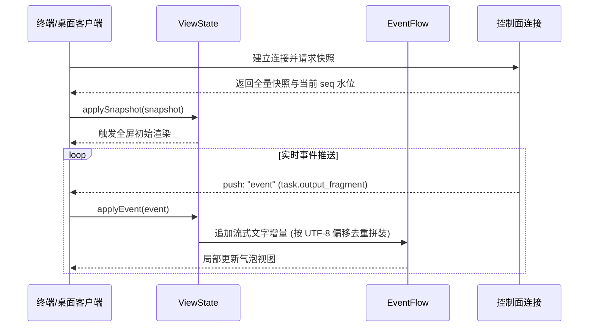

# 共享界面投影与历史恢复

## 职责与边界

`@ruukoto/view`（对应 `packages/view/src/`）是为前端客户端（终端 TUI、Web 控制台与桌面客户端）提供共享内存状态投影、流式事件流合并与历史会话恢复的核心状态层。

### 核心职责
- **内存视图投影（`ViewState`）**：将控制面返回的系统快照与增量持久事件，投影为客户端 UI 易于绑定的响应式会话、任务与审批树；排队顺序取持久 `queue_order`，排队输入只在排队区展示、不入聊天流，引导路由按源 Task ID 投影（待接入源不进队列，已接入气泡按真实接入时刻定位，已开始任务按执行开始定位）。侧聊会话凭 `sideChats` 绑定（side→parent）识别，不进入普通会话投影，客户端经专用悬浮层打开。
- **事件流合并与对齐（`EventFlow`）**：将模型流式输出的文本片段（`output_fragment`）、思考推理片段（`thinking`）与工具调用结果按时间线精准合并。
- **会话历史窗口恢复（`HistoryRecovery`）**：在用户向前翻页或打开既有会话时，编排历史消息的分页拉取与正文补齐。
- **纯浏览器环境运行**：全包不依赖 Node.js 内置模块与全局变量，可无缝运行在现代浏览器、Electron Renderer 与终端环境。

### 边界与非职责
- 底层 Unix Socket 连接管理与 RPC 通信归 [control](control.md)。
- 终端具体渲染排版与按键交互归 [tui](tui.md)。
- 桌面窗口管理与本地生命周期归 [desktop](desktop.md)。

## 对外接口

| 核心类 / 函数 | 适用环境 | 职责与行为描述 |
|---|---|---|
| `ViewState.applySnapshot` | 浏览器 / Node | 安装全量连接快照，初始化项目列表、活动会话、待决审批与 SubAgent 清单 |
| `ViewState.applyEvent` | 浏览器 / Node | 增量应用单条持久事件，平滑驱动 UI 状态流转（任务开始、输出增长、审批生成） |
| `EventFlow` | 浏览器 / Node | 维护单会话的消息流时间线，将零散的文本碎片与工具结果对齐拼装为完整消息项 |
| `HistoryRecovery` | 浏览器 / Node | 历史消息分页加载编排器，按 UTF-8 字节偏移续读长正文，杜绝卡顿 |
| `personal-protocol.ts` | 浏览器 / Node | 导出 PA 桌面与移动端通用的时间线与协议类型定义（纯 TypeScript 类型） |

## 数据与状态

### 1. 客户端视图数据树

```
ViewState (根快照)
├── activeSessionId          # 当前选中的会话
├── sessions                 # 会话列表 (按工作区隔离)
│   └── [sessionId]
│       ├── tasks            # 任务历史与当前执行任务
│       ├── pendingApprovals # 该会话待决的审批项列表
│       └── eventFlow        # 实时合并的时间线流 (包含模型思考、输出与工具)
└── backgroundProcesses      # 会话关联的后台服务与日志索引
```

### 2. 状态恢复两阶段流程

当客户端接入服务端时，状态恢复严格按两阶段执行：
1. **快照重置（Snapshot Reset）**：安装 `ConnectResult` 快照，建立基准状态；
2. **事件对齐（Event Replay）**：若存在快照之后的未消费事件，按 `seq` 顺序重放补发，确保与服务端完全对齐。

## 主要流程

### 客户端快照加载与流式事件渲染流程



1. **初始装配**：客户端接收到连接快照后，`ViewState` 一次性建立项目与会话索引，并展示初始历史消息。
2. **增量流式追加**：模型生成回复时，`EventFlow` 根据片段偏移量原子拼接文本与思考过程，即便在网络乱序场景下也能保证顺序正确。
3. **按需长文本加载**：若历史中存在超过单页大小的超长回答，`HistoryRecovery` 异步向服务端请求正文切片，平滑拼接进视图。

## 不变量与失败处理

- **零 Node.js 依赖污染**：全包严格遵守 Web 跨平台标准，静态检查与测试杜绝任何 `node:*` 模块与 Node 全局变量，保障在纯浏览器环境中稳定运行。
- **事件版本防回滚**：当由于网络重试收到早于当前视图版本的旧事件时，`ViewState` 主动忽略，防止页面闪烁或状态倒退。
- **分页连续性校验**：历史正文拉取时严格校验返回切片的起始偏移量是否与当前已读字节连续，发生空洞时抛出明确异常并请求重拉，拒绝展示残缺内容。

## 设计依据

- [双端共用会话历史恢复](../../.agents/notes/implemented/architecture/2026-10-23-shared-history-recovery.md)
- [完整思考与文件预览](../../.agents/notes/implemented/feature/2026-10-18-complete-reasoning-and-preview.md)
- [同仓 workspaces 分包](../../.agents/notes/implemented/architecture/2026-10-11-in-repo-workspace-packages.md)
- [桌面客户端作为又一个控制面客户端](../../.agents/notes/proposed/architecture/2026-10-15-desktop-client.md)
