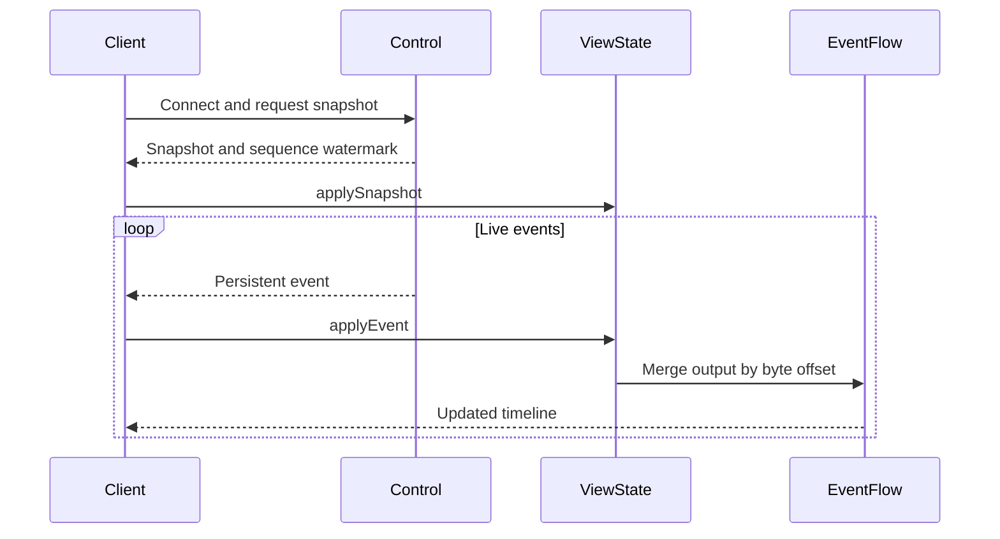

# Shared UI Projection and History Recovery

## Responsibilities and Boundaries

`@ruukoto/view` provides browser-safe state projection, event-flow assembly and history recovery for TUI and desktop clients. It contains no Node built-ins or globals. [Control](control.md) owns transport; [TUI](tui.md) owns terminal layout and input; [desktop](desktop.md) owns native windows and hosts.

`ViewState` projects snapshots and committed events into conversations, tasks, approvals and SubAgents. Queue order follows persisted `queue_order`; queued inputs appear only in the queue, not the chat. Guidance is keyed by source Task: pending guidance is not an ordinary queued message, consumed guidance appears at its actual injection time, and executed tasks appear at start time. `sideChats` binds side conversations to parents and excludes them from the ordinary conversation list; clients open them through a dedicated overlay.

## Public Interfaces

| Entry | Purpose |
| --- | --- |
| `ViewState.applySnapshot` | Install projects, conversations, approvals and SubAgents from the connection snapshot |
| `ViewState.applyEvent` | Apply a persistent state/output event |
| `EventFlow` | Align text, thinking and tools into one conversation timeline |
| `HistoryRecovery` | Coordinate history pages and long-body reads using UTF-8 byte offsets |
| `personal-protocol.ts` | Browser-safe PA timeline and protocol types |

All interfaces work in browsers and Node; transport is supplied by the client.

## Data and State

```text
ViewState
├── activeSessionId
├── sessions (grouped by workspace)
│   └── conversation: tasks, approvals and event flow
└── backgroundProcesses (status and log references)
```

Recovery first installs the `ConnectResult` snapshot, then applies subsequent events in sequence order. Older events must not roll the view back.

## Main Flows



Initial projection establishes indexes before rendering. Streamed text and thinking join using their offsets rather than arrival timing alone. When older or oversized content is needed, `HistoryRecovery` requests bounded slices and stitches them into the same view.

## Invariants and Failure Handling

- Lint and tests reject `node:*` imports and Node globals in this package.
- Stale event versions do not replace newer state.
- Default `read_history` excludes recalled contributions. `message_recall.changed` refreshes client recall state; only the initiator holding the original request key receives draft text and restored attachments through `message_recall_state`.
- History-body slices must start at the expected byte offset. Gaps fail explicitly and require recovery rather than displaying incomplete text as complete.

## Design Rationale

- [Shared history recovery](../../.agents/notes/implemented/architecture/2026-10-23-shared-history-recovery.md)
- [Complete reasoning and preview](../../.agents/notes/implemented/feature/2026-10-18-complete-reasoning-and-preview.md)
- [In repo workspace packages](../../.agents/notes/implemented/architecture/2026-10-11-in-repo-workspace-packages.md)
- [Desktop client](../../.agents/notes/proposed/architecture/2026-10-15-desktop-client.md)
