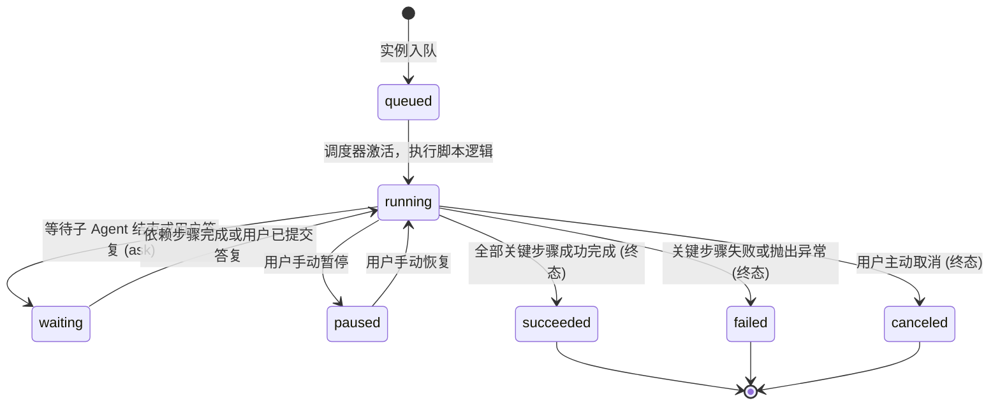
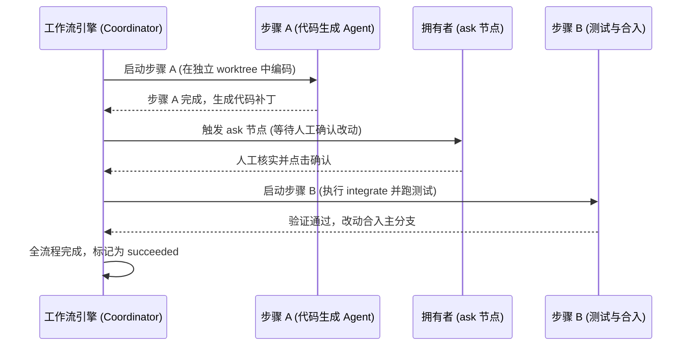

# 工作流定义与后台运行

## 职责与边界

`workflows` 模块（对应 `packages/runtime/src/workflows.ts`）为 Coding Agent 提供声明式、多步骤的后台自动化工作流编排引擎。

### 核心职责
- **流程脚本执行**：在受限脚本沙箱中运行工作流逻辑，支持并发派发任务、动态依赖编排与结果校验。
- **持久化步骤模型**：工作流中的每一个步骤（Step）作为持久实体落盘，支持断点恢复、进度追溯与状态可视化。
- **交互式问答（`ask`）**：在自动化流程的关键节点暂停并向拥有者发起问答交互，获取决策输入后继续向下执行。
- **代码改动受控汇入（`integrate`）**：将各步骤在独立 worktree 中生成的代码补丁进行组合检查与原子汇入。

### 边界与非职责
- 步骤内底层工具的实际沙箱执行归 [execution](execution.md)。
- 工作流外部调度与时间触发规则归 [scheduler](scheduler.md)。
- 个人 Agent 的日常任务与分析归 [personal-durable](personal-durable.md)。

## 对外接口

### 1. 脚本环境核心 API

在工作流脚本（JavaScript）中，开发者可通过全局上下文调用以下声明式原语：

| 脚本函数 | 参数核心字段 | 功能描述与关键契约 |
|---|---|---|
| `agent(key, params)` | `request`, `role`, `target`, `dependsOn`, `output` | 启动一个子 Agent 执行特定任务；支持依赖前序步骤，支持声明 JSON Schema 输出 |
| `ask(key, params)` | `question`, `options`, `dependsOn` | 挂起流程向人类发起决策提问，用户回答后继续推进后续步骤 |
| `integrate(key, params)`| `steps`, `check`, `dependsOn` | 将已通过验证的步骤产生的 Git 分支改动原子合入主工程，并执行自检命令 |
| `progress(key, params)` | `percentage`, `message` | 上报工作流当前执行进度与阶段说明 |

### 2. 宿主管理接口

| 宿主接口 | 调用方 | 职责与行为 |
|---|---|---|
| `WorkflowCoordinator.start` | 客户端 / 调度器 | 校验脚本完整性与预算配额，启动新的工作流运行实例 |
| `WorkflowLibrary` | TUI / 控制面 | 工作流脚本文件的存储库，支持命名工作流的存储、版本演进与模板管理 |
| `WorkflowCoordinator.control` | 控制面 / CLI | 人工干预工作流：支持暂停（pause）、恢复（resume）或取消（cancel）运行 |

## 数据与状态

### 1. 工作流运行状态机

### 2. 存储数据模型

- **`workflow_definitions`**：存储命名工作流脚本正文、版本号与内容哈希。
- **`workflow_runs`**：存储每次运行的实例元数据、输入参数、累计执行时间（Wall-clock time）与终态。
- **`workflow_steps`**：存储运行中各个步骤的依赖关系（`dependsOn`）、状态、输出内容与回执。
- **`workflow_questions`**：存储流程中挂起的人类问答记录与答案快照。

## 主要流程

### 多步骤依赖执行流程

1. **依赖解析与拓扑调度**：引擎依据 `dependsOn` 解析步骤拓扑图，无依赖的步骤并行推进，有依赖的步骤自动等待前序输出。
2. **人工审查插入**：流程遇到 `ask` 步骤时自动切入 `waiting` 状态，待用户在 TUI 或 Web 端提交答案后自动恢复。
3. **隔离验证与合入**：所有代码变更在独立工作目录中完成单元测试，验证成功后通过 `integrate` 安全合入。

## 不变量与失败处理

- **强类型依赖闭环**：步骤声明的 `dependsOn` 目标必须在同一次运行中存在且已登记；若前序依赖步骤失败，后续步骤自动跳过（skip），防止级联脏数据。
- **预算与超时硬限制**：每个工作流运行实例配置有严格的累计执行墙钟时间与 Token 预算配额，超限时流程自动暂停并安全保留已产生结果。
- **代码合入前置验证**：未通过测试验证的代码步骤严禁调用 `integrate`，杜绝破坏主代码库稳定性。

## 设计依据

- [工作委托、SubAgent 与任务](../../.agents/notes/implemented/architecture/2026-10-03-work-delegation-subagent-task.md)
- [Coding Agent 的原生受限执行](../../.agents/notes/implemented/architecture/2026-10-10-native-execution-sandbox.md)
