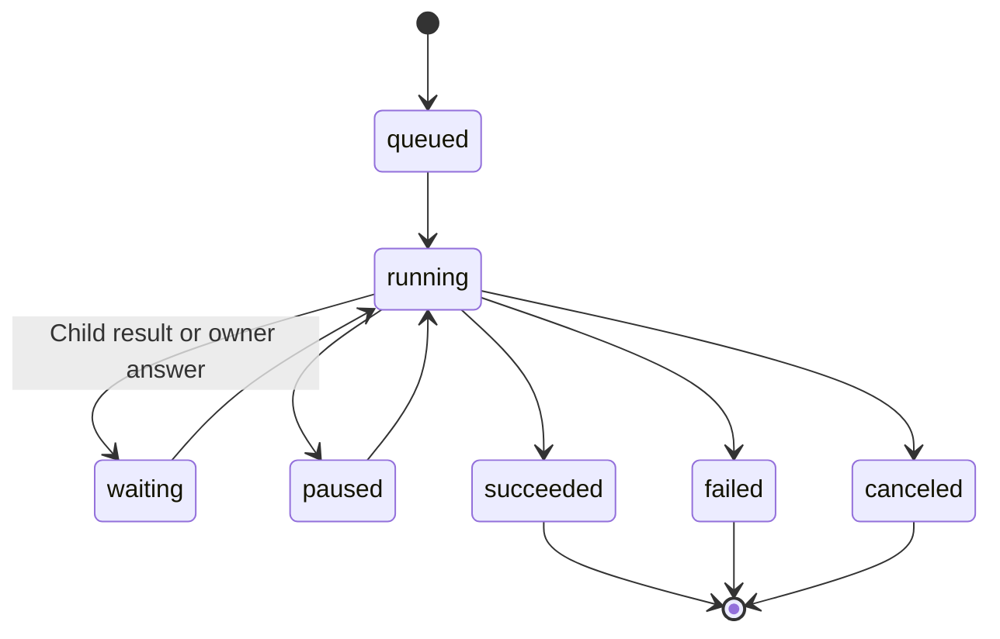
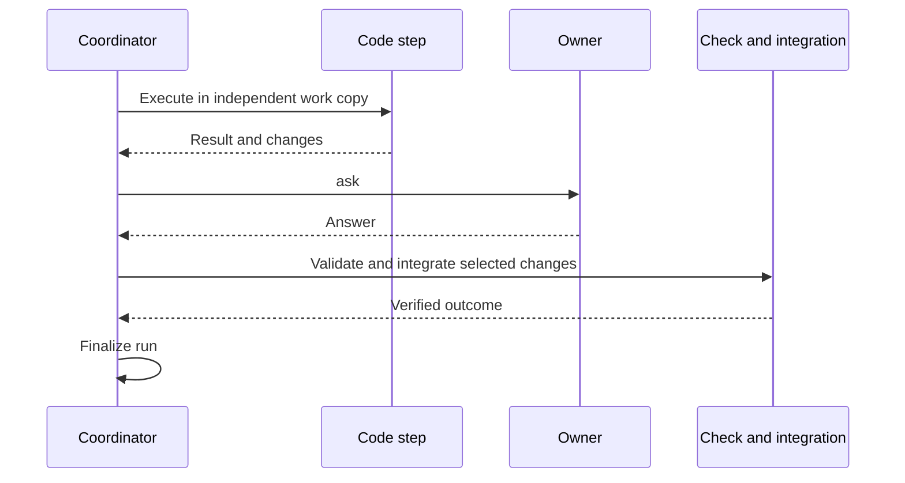

# Workflow Definitions and Runs

## Responsibilities and Boundaries

`packages/runtime/src/workflows.ts` coordinates Coding workflows: sandboxed scripts, persistent steps, dependencies, owner questions and controlled code integration. [Execution](execution.md) runs step tools; [scheduler](scheduler.md) owns time triggers; [Personal durable](personal-durable.md) owns the Personal product's work.

## Public Interfaces

| Script API | Main inputs | Purpose |
| --- | --- | --- |
| `agent(key, params)` | `request`, `role`, `target`, `dependsOn`, `output` | Run a child step with dependencies and optional JSON Schema output |
| `ask(key, params)` | `prompt`, `options`, `dependsOn` | Persist an owner question and wait for its answer |
| `integrate(key, params)` | `steps`, `check`, `dependsOn` | Check and integrate selected step changes |
| `progress(key, params)` | `text` | Report stage and progress |

| Host entry | Purpose |
| --- | --- |
| `WorkflowCoordinator.start` | Validate script and budget, then start a run |
| `WorkflowLibrary` | Store named, versioned scripts and templates |
| `WorkflowCoordinator.control` | Pause, resume or cancel a run |

## Data and State

`workflow_definitions` stores script versions and hashes; `workflow_runs` stores fixed inputs, timing and outcome; `workflow_steps` stores dependencies, output and receipts; `workflow_questions` stores questions and answer snapshots. Definitions and runs are distinct: updating a definition does not rewrite an existing run.

## Main Flows

Dependency-free work can run concurrently; dependent steps wait for registered predecessors. An `ask` result resumes the relevant work without approving tool operations. Integration checks isolated changes before bringing them into the main work copy.

A terminal workflow's internal report keeps its original run/version/source and fallback identity. For an active eligible Coding task, report text enters the next request after its current tool batch; idle tool-free summaries run before ordinary queued messages. Claims, actual model consumption and final reporting are separate persisted facts, and receiving a report does not transfer ownership of its source work. Workflow script `ask` retains its own step-wait contract; this does not grant `ask_user` to workflow steps.

Named MCP requirements use official `mcp__<server>__<tool>` names. Before calling the model, wait for registration and verify current source eligibility. Published definitions and capability snapshots stay unchanged: report unmatched requirements explicitly and use a revised definition for a new run.

## Invariants and Failure Handling

- Dependencies must refer to registered steps in the same run. Failed predecessors prevent dependent work from consuming invalid output.
- Agent-attempt and cumulative execution-time budgets bound the run; human waiting is excluded. Exhaustion pauses it while retaining results.
- Integration requires its declared verification, not just an Agent's claim that the code is correct.

## Design Rationale

- [Work delegation subagent task](../../.agents/notes/implemented/architecture/2026-10-03-work-delegation-subagent-task.md)
- [Native execution sandbox](../../.agents/notes/implemented/architecture/2026-10-10-native-execution-sandbox.md)
- [Mcp host responsibilities](../../.agents/notes/implemented/simplification/2026-10-26-mcp-host-responsibilities.md)
- [Next-request report delivery](../../.agents/notes/implemented/feature/2026-10-30-coding-report-delivery-boundary.md)
